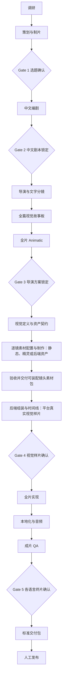

# 中国神话视频全流程总控工作流

本页是项目阶段、状态、门槛和交接的唯一权威来源。专业流程决定“如何做”，[项目配置](%E5%B7%A5%E4%BD%9C%E6%B5%81-%E9%A1%B9%E7%9B%AE%E9%85%8D%E7%BD%AE.md)决定“当前走哪条路线”，[跨仓库资产所有权](%E5%B7%A5%E4%BD%9C%E6%B5%81-%E8%B7%A8%E4%BB%93%E5%BA%93%E8%B5%84%E4%BA%A7%E6%89%80%E6%9C%89%E6%9D%83.md)决定“二进制属于哪里”。这些文件不得重新定义本页的状态机或门槛。

> [!important] 总原则
> 下游只绑定上游的具体 `locked` 版本。聊天、README、预览服务、计划文件和单次检查结果都不能代替正式产物及主题生产总控。

## 权威边界

| 事实 | 唯一权威位置 |
|---|---|
| 阶段、状态、五个门槛、交接 | 本页 |
| 活动 profile、默认值、兼容矩阵、路由 | [项目配置](%E5%B7%A5%E4%BD%9C%E6%B5%81-%E9%A1%B9%E7%9B%AE%E9%85%8D%E7%BD%AE.md) |
| 稳定仓库身份 | [依赖仓库注册表](https://github.com/lseyesl/ancient-tales-blender/blob/main/docs/archive/vault-environment/%E4%BE%9D%E8%B5%96%E4%BB%93%E5%BA%93%E6%B3%A8%E5%86%8C%E8%A1%A8.md) |
| 当前环境路径、配置 remote 与后端 executable | `工作流/环境配置.json`；由 `工作流/resolve_environment.py` 解析 |
| 二进制所有权、稳定路径、资产状态、跨仓库提交 | [跨仓库资产所有权](%E5%B7%A5%E4%BD%9C%E6%B5%81-%E8%B7%A8%E4%BB%93%E5%BA%93%E8%B5%84%E4%BA%A7%E6%89%80%E6%9C%89%E6%9D%83.md) |
| 专业内容、确认与版本事实 | 对应专业产物 |
| 当前主题绑定和下一动作 | `项目/<主题>/制作/生产总控.md` |

发生冲突时不猜测：专业产物或后端事实与生产总控不一致，主题整体标为 `blocked`；配置说明与项目配置不一致，以项目配置为准；已删除的旧工作流不得被恢复为活动规则。

## 阶段与门槛



镜头素材规划与输出的专业要求见[美术设计与资产](%E5%B7%A5%E4%BD%9C%E6%B5%81-%E7%BE%8E%E6%9C%AF%E8%AE%BE%E8%AE%A1%E4%B8%8E%E8%B5%84%E4%BA%A7.md#%E9%95%9C%E5%A4%B4%E7%B4%A0%E6%9D%90%E8%A7%84%E5%88%92%E4%B8%8E%E8%BE%93%E5%87%BA)。该步骤细化资产到样片之间的分工，不新增 Gate；Blender／Godot 主要负责素材组装、时间线和视频输出，另承担素材方案明确分配的后端制作项。

发布不属于自动生产终点。系统终点是通过 Gate 5 的标准交付包。

## 统一状态机

所有新建或实质更新的正式阶段产物只能使用：

```text
draft → review → approved → locked
          ↘ blocked
locked → needs-sync
```

| 状态 | 含义 | 可否被正式下游绑定 |
|---|---|---|
| `draft` | 尚在制作 | 否 |
| `review` | 内容完整，等待确认 | 否 |
| `approved` | 本阶段内容已确认 | 仅可准备交接 |
| `locked` | 已作为正式上游锁定 | 是 |
| `blocked` | 存在关键缺口或冲突 | 否 |
| `needs-sync` | 锁定后上游发生影响性变化 | 否 |

工作流说明页自身使用 `active` 或 `archived`，不属于生产状态机。历史产物中的旧复合状态保留原样；新任务不得复制这些旧值。

## 生产总控契约

主题通过 Gate 1 并准备进入编剧前，建立唯一固定文件：

```text
项目/<主题>/制作/生产总控.md
```

该文件不版本化、不改名，只汇总当前绑定和一致性，不拥有专业内容。历史主题缺失或使用旧字段时，本轮不批量改写；其下一次正式生产动作必须先审计并建立合规版本。

### 必需字段

```yaml
topic: <主题>
type: production-control
status: draft|review|approved|locked|blocked|needs-sync
current_stage: <阶段键>
current_gate: gate-1|gate-2|gate-3|gate-4|gate-5|delivery
consistency_status: pass|blocked|needs-audit
next_allowed_action: <一个明确动作>
content_master: "[[<locked 中文母版剧本>]]"
director_master: "[[<locked 分镜总表>]]"
director_storyboard_master: "[[<locked 全篇视觉故事板>]]"
director_animatic_master: "[[<locked 全片 Animatic 记录>]]"
storyboard_coverage_status: pass|fail|needs-audit
animatic_timeline_status: pass|fail|needs-audit
expected_shot_count: <整数>
expected_fps: <整数>
expected_total_frames: <整数>
expected_duration_seconds: <数值>
actual_shot_count: <整数或 null>
actual_fps: <整数或 null>
actual_total_frames: <整数或 null>
actual_duration_seconds: <数值或 null>
timeline_consistency: pass|fail|needs-audit
director_review_status: pending|pass|changes-requested|blocked
director_taste_review_status: pending|pass|changes-requested|blocked
updated: YYYY-MM-DD
```

禁止使用 `pre-gate-*`、`passed`、`pending-formal-*` 等近义扩展值。需要表达细节时写入正文，不扩展枚举。

### 一致性门禁

满足以下全部条件才能把 `consistency_status` 写为 `pass`：

- 所有当前绑定链接存在，且上游状态允许绑定；
- 进入 Gate 3 或任何正式下游时，`storyboard_coverage_status` 与 `animatic_timeline_status` 均为 `pass`；
- 主题配置指向项目配置中登记的兼容组合；
- 进入全片、音频或成片阶段时，预期与实际镜号、镜头数、帧率、总帧数、总时长和内容母版均已对账；
- 当前后端仓库、commit、相对路径和工作树状态有实际检查证据；
- `timeline_consistency` 为 `pass`。

平台样片只覆盖代表镜头时，必须把“全片时间轴”和“样片时间轴”分开记录；样片通过不能冒充全片时间轴通过。实际镜头数或总帧数为零时不得写 `pass`。

发现缺失或冲突时：

1. `status: blocked`；
2. `consistency_status: blocked` 或 `needs-audit`；
3. `next_allowed_action` 只允许修复或审计；
4. 不继续正式下游。

## 五个硬门槛

### Gate 1：选题确认

权威流程：[策划与制片](%E5%B7%A5%E4%BD%9C%E6%B5%81-%E7%AD%96%E5%88%92%E4%B8%8E%E5%88%B6%E7%89%87.md)。

确认受众、规格、时长、叙事角度、证据成熟度、改编边界、制作范围和明确不做的内容。选题正式交给编剧时必须为 `locked`。

### Gate 2：中文剧本锁定

权威流程：[编剧](%E5%B7%A5%E4%BD%9C%E6%B5%81-%E7%BC%96%E5%89%A7.md)。

确认中文内容母版、事实与改编边界、旁白对白、节拍、目标时长和屏幕事实标识。导演只绑定 `locked` 中文母版。

### Gate 3：导演方案锁定

权威流程：[导演](%E5%B7%A5%E4%BD%9C%E6%B5%81-%E5%AF%BC%E6%BC%94.md)。

确认镜号、镜头时长、视觉语法、表演、声音、连续性、镜内元素事件链和制作可行性；同时确认全篇视觉故事板无缺镜、无缺关键动作状态，并将全部图板按正式镜序与时长组成可连续观看的 Animatic。文字分镜、全篇故事板和 Animatic 必须共同锁定；缺少任一项或三者的镜号、顺序、时长、事件链不一致时，Gate 3 保持阻断。后端不得静默改变镜头结构或叙事因果。

### Gate 4：平台真实视觉样片确认

权威流程：主题绑定后端主入口的“平台视觉样片”阶段。

使用当前后端已确认的真实资源制作 3–5 个代表镜头，并验证构图、表演、运动、遮挡、特效、排版、连续性和实际时间轴输出。静态概念图、拆件板、节点树或单项技术测试不能通过 Gate 4。用户或已登记授权确认者确认、导演审阅 `pass`、后端提交和 Vault 记录提交均完成后方可锁定。

### Gate 5：各语言终片确认

权威流程：[成片合成与质量检查](%E5%B7%A5%E4%BD%9C%E6%B5%81-%E6%88%90%E7%89%87%E5%90%88%E6%88%90%E4%B8%8E%E8%B4%A8%E9%87%8F%E6%A3%80%E6%9F%A5.md)。

每个 locale 独立完成内容、字幕、音频、视觉、时间和技术 QA，并生成 clean、subbed、locale 字幕 JSON、SRT、VTT、QA 报告和 delivery manifest。一个语言通过不代表其他语言通过。

## 版本与交接

新建阶段产物至少记录：

```yaml
topic: <主题>
version: v1
status: draft
workflow_config: "[工作流-项目配置](%E5%B7%A5%E4%BD%9C%E6%B5%81-%E9%A1%B9%E7%9B%AE%E9%85%8D%E7%BD%AE.md)"
workflow_config_version: <主题绑定版本>
upstream:
  - "[[<具体上游版本>]]"
approved_at:
approved_by:
locked_at:
supersedes:
```

- 上游必须指向具体文件版本，不能只写目录。
- 影响事实、结构、台词、镜号或时长的变化必须建立新版本，并使既有下游 `needs-sync`。
- 拼写或不影响下游的元数据修正可在原版本更新并记录。
- `approved_at`、`approved_by`、`locked_at` 只能依据真实确认填写。

正式交接至少记录：阶段、上游版本与状态、下游目标、门槛依据、风险、阻塞项、确认者和确认日期。

## 确认、验证与 Git 提交

### 最小提交粒度

- `draft`／`review` 候选过程默认留在所有者仓库工作树，不写回 Vault，也不要求正式 commit。
- 候选跨会话、需要多人交接或存在高丢失风险时，可以创建一个明确标为 candidate／WIP 的实现仓库 checkpoint；它不能作为正式下游身份，也不触发三份 Vault 状态文档同步更新。
- 用户批准、Gate 通过或正式交接是提交里程碑。同一连续阶段内彼此依赖的多个确认可以合并为一个实现提交和一个 Vault 追踪提交，只要批准对象、确认者、日期、版本、路径与 SHA-256 均可逐项追溯。
- 不得仅为了“状态看起来更完整”提交未改变事实的 handoff、README 或重复状态副本。

正式批准或 Gate 里程碑执行：

1. 确认被审内容 SHA-256 未改变；改变内容必须退回 `review`，不能沿用原批准；
2. 写入确认者、日期、状态和批准回执；
3. 运行该阶段唯一聚合校验；内容与依赖未变时不得重建二进制、审阅图、`.blend` 或媒体；
4. 只暂存精确文件，不使用 `git add .` 或 `git add -A`；
5. 检查一次暂存清单与 `git diff --cached --check`，创建里程碑 commit；
6. 跨仓库批准先提交所有者仓库，再在 Vault 一次性回写该里程碑并提交；任一必要提交失败都不得写为 `locked`。

### 验证预算

#### 按变更范围检查

| 范围 | 执行要求 | 记录时机 |
|---|---|---|
| 局部返修 | 只检查受影响镜头／模块的加载、预览与目标缺陷；动作修改须连续播放 | 候选保留在所有者仓库，简记预览、变化、残留问题 |
| 共享结构变更 | 检查共享资产、骨骼、接口及受影响依赖，回看代表镜头；无法确定影响范围时扩大检查 | 更新必要依赖和候选记录 |
| 正式里程碑 | 运行当前阶段唯一聚合入口，完成规定的视觉审阅、批准与身份核对 | 按最小提交粒度集中回写 |

每轮先确定目标画面与本轮可观察问题，优先生成可看预览。普通候选返修不运行全仓公共测试；修改公共管线时才按实现仓库规则运行对应测试。工作流校验器只在活动规则、路由或配置变更时运行。

复用检查结果必须确认输入内容、依赖、工具／检查器版本和相关配置均未变化，并能定位原结果与覆盖范围；任何一项变化只使受影响结果失效，不能把未检查项写为通过。低成本预览不能冒充正式证据；正式送审仍满足对应契约。已完成的同范围检查不因切换入口重复运行。

#### 记录与恢复

生产总控只在批准绑定、阶段、阻塞事实或下一允许动作发生实质变化时更新；README 保留稳定导航，不复制候选进度；Handoff 仅在实际跨阶段交接或用户要求时更新。候选跨会话可在所有者仓库保存简短 checkpoint，不要求三份 Vault 文档同步。

恢复时核对权威入口与实际候选；同一会话连续制作只读取变化范围。候选推进不自动使已批准绑定失效，发现实际矛盾仍按一致性门禁处理。

#### 执行预算

- 正式里程碑使用阶段聚合验证入口；局部返修和共享结构变更按上表执行。单项探针只用于诊断或覆盖缺口，不得全部重复运行后再运行同等范围的总验证。
- 默认单次无界面构建、校验或审阅渲染预算为 300 秒；后端确需更长预算时必须在主题实现记录中事先声明理由和上限。
- 超时即停止该命令并将当前动作记为 `blocked`；不得无限等待，也不得原样重复失败命令。
- Git 状态检查默认三次：写入前保护工作树、提交前核对范围、提交后确认结果；不在每个微步骤后重复检查。

## 变更与历史兼容

- 项目默认配置变化只影响尚未绑定的新主题；现有主题不自动迁移。
- 历史产物、历史状态和历史链接不批量改写。
- 退役工作流仅用于解释历史记录，不能成为新任务入口。
- 历史主题重新进入正式生产时，先建立新主题配置版本并审计生产总控，再决定是否迁移。
- README、计划文件和聊天不得保存另一份“当前生产状态”。

## 总控检查表

- [ ] 已读取项目配置和主题生产总控。
- [ ] 当前状态、门槛和一致性字段使用合法枚举。
- [ ] 所有正式下游绑定具体 `locked` 上游。
- [ ] Gate 3 同时绑定文字分镜、全篇视觉故事板和全片 Animatic，且镜号、顺序、时长与事件链一致。
- [ ] 样片与全片时间轴没有混写。
- [ ] 配置组合已登记且兼容。
- [ ] 跨仓库资源具有 repository、commit、相对路径和 SHA-256。
- [ ] 用户或授权确认者的批准已写入对应里程碑；没有为候选微状态制造重复提交。
- [ ] 下一允许动作唯一、明确且没有越过门槛。


> 迁移说明（2026-11-04）：本页专业规范须服从上层 SKILL.md 的现行所有权与存储边界；旧 Vault 写回、旧环境配置与自动提交规则已退役。
