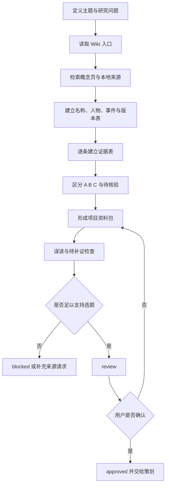

# 中国神话视频神话调研工作流

本流程用于把一个神话主题或研究问题转化为可供策划、编剧和视觉设计使用的项目资料包。它负责具体执行与交接；项目 `AGENTS.md` 和 `ai-wiki/AGENTS.md` 继续负责目录权限、来源层和证据边界。

下游流程：[策划与制片工作流](%E5%B7%A5%E4%BD%9C%E6%B5%81-%E7%AD%96%E5%88%92%E4%B8%8E%E5%88%B6%E7%89%87.md)。

> [!important] 核心原则
> **先找来源，再分层主张，最后形成项目资料包。**
>
> 资料包不是权威来源，也不是成片旁白。它只能引用和综合来源，不能替代 `ai-wiki/sources/` 中的原始依据。

## 输入与默认产物

必需输入：

- 主题、人物、神祇、异兽或事件；
- 本次要回答的研究问题；
- 预期用途是中国神话视频；
- 已知别名、相关人物或关键母题（如有）。

默认产物：

```text
项目/<主题>/调研/
└── 资料包.md
```

frontmatter 最小字段：

```yaml
title: <主题>资料包
tags:
  - projects/video
  - research
  - mythology
type: research-pack
status: draft
created: YYYY-MM-DD
updated: YYYY-MM-DD
topic: <主题>
version: v1
sources: []
upstream: []
downstream: []
approved_at:
approved_by:
supersedes:
```

## 调研状态

资料包使用[总控统一状态机](%E5%B7%A5%E4%BD%9C%E6%B5%81-%E5%85%A8%E6%B5%81%E7%A8%8B%E6%80%BB%E6%8E%A7.md#%E7%BB%9F%E4%B8%80%E7%8A%B6%E6%80%81%E6%9C%BA)。本阶段的关键转换是：结构和证据边界完整后进入 `review`；关键主张可供策划使用后为 `approved`；被具体选题绑定后为 `locked`。核心叙事缺少来源或关键冲突无法判断时为 `blocked`；锁定后发现影响性新来源或纠错时为 `needs-sync`。

资料包不需要穷尽所有学术问题才可 `approved`；但影响选题核心事实、人物身份、版本关系或高风险误读的问题不能留作非阻塞项。

## 调研流程



## 阶段一：定义研究问题

不要只写“研究女娲”这类无限范围。至少明确：

- 主题的规范名与目录名；
- 需要辨析的别名或同名人物；
- 视频可能使用的核心事件；
- 需要核验的外形、地点、关系和因果；
- 用户特别关心的版本、误读或视觉特征。

如果用户只给出主题，先按项目默认资料包结构研究核心叙事，不擅自决定最终视频立场。

## 阶段二：按顺序检索

1. 读取 `ai-wiki/wiki/index.md`。
2. 读取 `ai-wiki/wiki/domains/中国古代文献与神话.md`。
3. 读取已有概念页和相关主题资料包。
4. 在 `ai-wiki/sources/` 中检索主题名、别名、人物关系、地点和母题。
5. 优先定位原始文献，再读注疏、校勘、后世文献和现代研究。
6. 记录没有找到的关键材料，不用常识补空。

`ai-wiki/sources/` 默认只读。现有本地来源不足时：

- 说明缺口会不会阻塞当前资料包；
- 只有用户同意补充时才执行外部摄取；
- 摄取、Wiki 写回、索引和日志遵守 `ai-wiki/AGENTS.md`；
- 不为了完成项目资料包而直接修改来源文件。

## 阶段三：建立证据表

每条重要主张至少包含：

| 主张 | 证据级别 | 来源 | 文本层次／时代 | 可用表达 | 可信边界 |
|---|---|---|---|---|---|
| 示例主张 | A／B／C／待核验 | wikilink | 原文／注释／后世／现代 | “古籍记载”或归属语 | 不支持什么 |

证据分级：

- **A**：原始文献记录；
- **B**：注疏、校勘和后世文献；
- **C**：现代整理与研究解释；
- **D**：项目创作推演，只能出现在视频角度或创作建议中；
- **待核验**：当前无法判断，不补全猜测。

调研阶段不能用 D 级推演填补 A／B／C 的来源空白。

## 阶段四：资料包结构

资料包必须包含：

1. 制作摘要；
2. 核心古籍记录；
3. 证据表；
4. 版本与流变；
5. 人物与叙事结构；
6. 视觉和声音母题；
7. 高风险误读；
8. 视频角度；
9. 来源索引；
10. 待补证问题；
11. 调研放行结论。

### 调研放行结论

末尾必须明确：

| 项目 | 结论 |
|---|---|
| 核心叙事是否有 A 级依据 | 是／否 |
| 哪些版本可以组合 | 列出边界 |
| 哪些问题阻塞选题 | 无或具体问题 |
| 哪些问题可以后补 | 非阻塞问题 |
| 建议进入策划的角度 | 2–4 个，不替用户决定 |
| 当前状态建议 | `review`／`blocked` |

## 阶段五：审阅与放行

进入 `review` 前检查：

- 核心事件、人物、地点和形象均有来源或明确待核验；
- A、B、C 没有合并成无来源段落；
- 后世续衍没有冒充早期经文；
- 现代解释均有研究者归属；
- D 级建议与事实分开；
- 重要来源使用可点击 wikilink；
- 高风险误读和待补证项完整；
- 文件位于 `projects/中国神话视频/项目/<主题>/调研/`。

用户确认资料包足以进入选题后：

- `status` 改为 `approved`；
- 填写 `approved_at` 和 `approved_by`；
- 在“调研放行结论”记录确认范围；
- 交给策划与制片工作流。

当具体选题页正式绑定该资料包时，可将资料包标为 `locked` 并在 `downstream` 添加该选题页。后续发现影响核心选题的新证据时，资料包建立新版或标记 `needs-sync`，不得静默改变已锁定选题。

## 调研交接清单

- [ ] 主题和研究问题明确。
- [ ] 默认检索顺序已执行。
- [ ] 核心叙事至少有一项 A 级来源，或已明确 `blocked`。
- [ ] 证据表包含来源、层次和可信边界。
- [ ] 已区分版本、异文、后世续衍和现代解释。
- [ ] 已列出 2–4 个可选视频角度及其风险。
- [ ] 待补证问题已区分阻塞与非阻塞。
- [ ] 用户确认范围已写入文件，而非只留在聊天中。
- [ ] 下游能准确链接到该资料包版本。


> 迁移说明（2026-11-04）：本页专业规范须服从上层 SKILL.md 的现行所有权与存储边界；旧 Vault 写回、旧环境配置与自动提交规则已退役。
