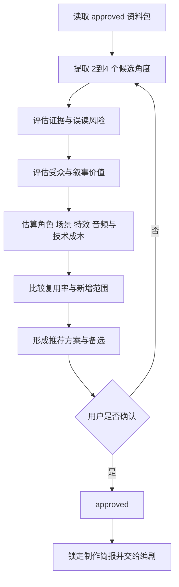

# 中国神话视频策划与制片工作流

本流程位于调研与编剧之间，负责从已核验的资料包中选择可制作的叙事角度，确定受众、规格、范围和成本，并完成第一个硬门槛“选题确认”。

上游流程：[神话调研工作流](%E5%B7%A5%E4%BD%9C%E6%B5%81-%E7%A5%9E%E8%AF%9D%E8%B0%83%E7%A0%94.md)。  
下游流程：[编剧工作流](%E5%B7%A5%E4%BD%9C%E6%B5%81-%E7%BC%96%E5%89%A7.md)。

> [!important] 核心原则
> **选题不是“最喜欢哪个故事”，而是在证据、受众价值、叙事强度和制作成本之间做可追踪的选择。**
>
> 策划可以决定采用哪个角度，不能改变资料包中的来源事实；制片可以缩小制作范围，不能把尚未解决的关键风险藏到编剧或导演阶段。

## 输入与默认产物

必需输入：

- `approved` 的主题资料包；
- 资料包中的候选视频角度；
- 目标平台、受众或用户已知偏好；
- 当前可复用资产和制作能力；
- 时间、成本或技术限制（若未知则明确为待确认）。

默认产物：

```text
项目/<主题>/策划/
└── <叙事角度>-v1.md
```

最小 frontmatter：

```yaml
title: <主题>·<叙事角度>
tags:
  - projects/video
  - mythology
  - planning
type: video-direction
status: draft
created: YYYY-MM-DD
updated: YYYY-MM-DD
topic: <主题>
version: v1
research_pack: "[[projects/中国神话视频/项目/<主题>/调研/资料包]]"
upstream:
  - "[[projects/中国神话视频/项目/<主题>/调研/资料包]]"
downstream: []
approved_at:
approved_by:
supersedes:
```

## 状态与门槛

选题页使用[总控统一状态机](%E5%B7%A5%E4%BD%9C%E6%B5%81-%E5%85%A8%E6%B5%81%E7%A8%8B%E6%80%BB%E6%8E%A7.md#%E7%BB%9F%E4%B8%80%E7%8A%B6%E6%80%81%E6%9C%BA)。制作范围完整后进入 `review`；通过 Gate 1 后为 `approved`；被具体中文剧本绑定后为 `locked`。证据、成本或规格不足时为 `blocked`；资料包发生影响性变化时为 `needs-sync`。

## 策划与制片流程



## 阶段一：候选角度

从资料包中提取 2–4 个候选。每个候选写清：

- 一句话故事或核心问题；
- 视频类型：故事演绎、知识辨析、版本比较或人物专题；
- 使用哪些 A／B／C 材料；
- 需要哪些 D 级改编；
- 核心冲突与观众获得；
- 最容易产生的误读；
- 不包含哪些相邻故事或后世元素。

不得用未经资料包支持的网络印象补成候选角度。

## 阶段二：选题评分

使用 1–5 分进行相对比较。分数用于暴露取舍，不替用户自动决定。

| 维度 | 判断问题 | 高分含义 |
|---|---|---|
| 证据成熟度 | 核心表达是否有可靠来源 | 边界清楚、待补证不阻塞 |
| 叙事强度 | 是否有清晰目标、阻碍和变化 | 能形成完整观看体验 |
| 受众价值 | 观众为何要看 | 有情绪、知识或辨伪收益 |
| 视觉潜力 | 是否有可见动作、空间和母题 | 容易形成独特镜头 |
| 资产复用率 | 现有角色、场景、道具能否复用 | 新增成本较低 |
| 制作可行性 | 当前工具和时间能否实现 | 无关键技术阻塞 |
| 误读风险 | 是否容易把改编当事实 | 风险低或可清晰标识 |

推荐表：

| 候选 | 证据 | 叙事 | 受众 | 视觉 | 复用 | 可行性 | 风险 | 结论 |
|---|---:|---:|---:|---:|---:|---:|---:|---|
| 角度 A |  |  |  |  |  |  |  | 推荐／备选／暂缓 |

高总分不自动胜出。若核心事实不可靠或风险无法清楚标识，该角度直接 `blocked`。

## 阶段三：制作范围

选定推荐方向后确定：

### 受众与发行规格

- 目标平台；
- 目标受众；
- 目标时长；
- 横屏／竖屏、画幅和分辨率；
- 叙事形式：旁白、对白或混合；
- 中文作为内容母版；
- 首轮语言需求只记录范围，不在本阶段制作翻译。

### 创作边界

- 采用的文献和版本；
- 明确保留的原典事实；
- 允许的 D 级人物动机、对白和连接情节；
- 必须显示的原典、后世版本、研究解释和改编标识；
- 禁止混同的人物、年代或故事层。

### 初步资源估算

| 类别 | 估算内容 |
|---|---|
| 角色 | 数量、造型变体、表情和动作 |
| 场景 | 地点、时段、天气和可复用背景 |
| 道具 | 关键叙事道具及状态变化 |
| 特效 | 水、火、云、法术、转场等 |
| 声音要求 | 配音角色数、音乐段落、关键音效 |
| 技术风险 | 新动作、新渲染能力或高成本镜头 |
| 可复用项 | 已存在的资产和组件 |
| 明确不做 | 本版本排除的内容 |

声音在本阶段只形成要求，不假装已经获得音频文件。

## 阶段四：制作简报

选题页正文至少包含：

1. 创作定位；
2. 一句话故事或核心问题；
3. 目标受众与平台规格；
4. 采用的来源与证据边界；
5. 叙事模式与核心冲突；
6. 真实性和改编标识；
7. 预计角色、场景、道具、特效和声音需求；
8. 可复用资产与新增成本；
9. 高风险误读和规避方式；
10. 本版本明确不做的内容；
11. 推荐理由与备选方案；
12. 选题确认记录；
13. 编剧交接。

## 门槛一：选题确认

进入 `review` 后，请用户一次确认以下整体方案：

- 主题和叙事角度；
- 受众、平台、时长和画面规格；
- 采用的版本和改编程度；
- 核心冲突、情绪方向和结尾；
- 主要资产与技术成本；
- 明确不做的范围；
- 关键误读风险及标识方式。

确认后：

1. `status` 改为 `approved`；
2. 填写 `approved_at`、`approved_by`；
3. 在正文记录用户确认的方案；
4. 将资料包加入 `upstream`；
5. 交给编剧准备中文母版。

当编剧创建具体剧本并绑定该选题页时：

- 选题页改为 `locked`；
- `downstream` 添加剧本 wikilink；
- 后续改方向必须创建新版选题页；
- 已绑定的剧本不自动切换到新选题版本。

## 编剧交接清单

- [ ] 资料包状态可供选题使用。
- [ ] 已比较至少两个候选，或说明为什么只有一个可行角度。
- [ ] 用户已确认选题、受众、时长、平台和叙事形式。
- [ ] 来源事实、解释和 D 级改编边界清楚。
- [ ] 角色、场景、道具、特效和声音需求已有初估。
- [ ] 可复用资产、技术风险和明确不做的范围已记录。
- [ ] 选题页为具体版本，并链接具体资料包。
- [ ] 正式交给编剧时状态为 `locked`。


> 迁移说明（2026-11-04）：本页专业规范须服从上层 SKILL.md 的现行所有权与存储边界；旧 Vault 写回、旧环境配置与自动提交规则已退役。
