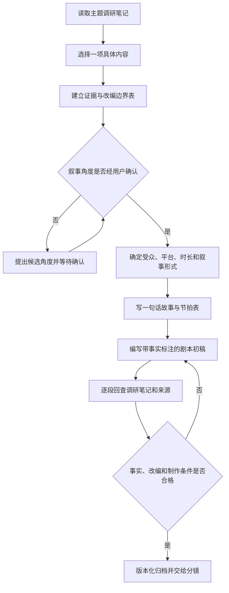

# 中国神话视频编剧工作流

本流程用于把已经通过选题确认的制作简报和其中选定的调研内容，发展成可供分镜和制作使用的中文母版剧本。项目目录沿用 `脚本/`；本文中的“剧本”指该目录内包含旁白、对白、场景和事实标注的脚本文档。

上游流程：[策划与制片工作流](%E5%B7%A5%E4%BD%9C%E6%B5%81-%E7%AD%96%E5%88%92%E4%B8%8E%E5%88%B6%E7%89%87.md)。

总控规则：[全流程总控工作流](%E5%B7%A5%E4%BD%9C%E6%B5%81-%E5%85%A8%E6%B5%81%E7%A8%8B%E6%80%BB%E6%8E%A7.md)。

> [!important] 核心原则
> **先选定调研内容和叙事角度，再区分事实与改编，最后编写剧本。**
>
> 调研笔记不是可直接润色的旁白稿。编剧可以重组材料、补足戏剧动作，但不得把推测、后世续衍或项目改编伪装成古籍原文。

## 何时使用

用户提出以下请求时读取并执行本流程：

- 从“调研笔记”或某份“资料包”选一个内容写成剧本；
- 把某条古籍记录、人物关系、事件链、版本差异或视频角度改编为脚本；
- 为中国神话视频编写旁白、对白、场景或完整故事；
- 修改既有脚本的叙事结构，同时需要回查调研依据。

如果用户只要求整理事实或补充来源，仍停留在调研阶段，不启动本流程。

## 输入与产物

### 必需输入

1. 主题，例如“女娲补天”；
2. `locked` 的具体选题页；
3. 选题页绑定的资料包；
4. 被选中的具体调研内容；
5. 已确认的叙事角度、平台、受众、时长和叙事形式。

“具体内容”必须能准确定位，可以是：

- 一个标题下的完整章节；
- 证据表中的一条或一组主张；
- 一段来源支持的事件链；
- 一组人物关系或冲突；
- 某个版本差异；
- 资料包提出的一个视频角度。

不要用“整份资料包”代替选择。若没有通过选题确认，只能生成候选、事实边界、梗概或节拍试稿，并退回策划与制片工作流；不得把完整剧本标为正式母版。

### 默认产物

```text
项目/<主题>/脚本/
└── <叙事角度>-v1.md
```

- 创建前确认 `项目/<主题>/脚本/` 已存在；
- 新稿从 `v1` 开始，修改时递增版本，不覆盖已交付版本；
- 文件名描述叙事角度或内容，不必重复主题名；
- 剧本必须同时链接具体选题页和资料包；
- 中文母版使用 `language: zh-CN`、`content_master: true`；
- 只有通过门槛二后，剧本才能从 `approved` 进入 `locked` 并正式交给导演。

### 剧本状态

剧本使用[总控统一状态机](%E5%B7%A5%E4%BD%9C%E6%B5%81-%E5%85%A8%E6%B5%81%E7%A8%8B%E6%80%BB%E6%8E%A7.md#%E7%BB%9F%E4%B8%80%E7%8A%B6%E6%80%81%E6%9C%BA)。初稿完整后进入 `review`；故事、事实边界和台词确认后为 `approved`；成为导演绑定的中文母版后为 `locked`。输入不足时为 `blocked`；锁定选题或资料包发生影响性变化时为 `needs-sync`。

## 编剧流程



### 阶段一：选择内容

先读取资料包的制作摘要、证据表、版本与流变、高风险误读、视频角度和待补证问题。然后填写：

| 字段 | 内容 |
|---|---|
| 调研笔记 | `[[projects/中国神话视频/项目/<主题>/调研/资料包]]` |
| 选中内容 | 章节名、主张或事件链 |
| 核心冲突 | 谁想做什么，受到什么阻碍 |
| 证据范围 | 可直接使用的 A／B／C 级材料 |
| 创作空间 | 允许补写的 D 级动作、动机和连接 |
| 禁止混同 | 不能拼接为同一事实的版本或人物 |
| 待补证项 | 是否会阻塞当前角度 |

如果选中内容没有足够的事件或冲突，先把它改写为知识型视频结构，不要强行虚构完整传奇：

1. 提出大众熟悉的说法；
2. 展示调研材料实际写了什么；
3. 对比分歧或后世变化；
4. 给出有边界的结论。

### 阶段二：锁定叙事角度

完整剧本开写前，必须存在通过门槛一并已锁定的具体选题页。编剧如发现叙事角度仍需改变，应退回策划流程建立新版选题，不能在剧本中静默改方向。

确认时同时记录：

- 一句话故事；
- 核心问题或戏剧冲突；
- 采用哪些版本；
- 是否进行故事演绎；
- 哪些内容会明确显示为“改编”“推演”或“研究者解释”。

未经确认，只能产出候选角度、事实边界表、故事梗概或节拍表，不得擅自扩写完整剧本。

### 阶段三：建立证据—戏剧映射

写稿前建立最小映射表：

| 剧情／表达 | 证据级别 | 调研依据 | 剧本处理 |
|---|---|---|---|
| 古籍明确记录的事件 | A | 链接到具体章节或来源 | 可写成“古籍记载” |
| 注疏、异文或后世续衍 | B | 标明时代和文本 | 明示版本，不冒充早期原文 |
| 现代研究解释 | C | 标明研究者 | 使用“某研究者认为”等归属语 |
| 动机、对白、动作和情节连接 | D | 项目创作推演 | 明示为改编，不作为事实陈述 |

同一场景可以同时包含不同证据层，但必须能逐项分辨。若为了戏剧连贯而合并多个来源，剧本开头或对应段落必须说明这是跨文本整合。

### 阶段四：先写节拍，再写场景

先用 5–12 个节拍完成骨架。每个节拍写清：

1. 本段的叙事功能；
2. 新增的信息或变化；
3. 人物目标与阻碍；
4. 使用的调研内容；
5. 证据层与改编点；
6. 预计时长。

节拍通过后，再展开为场景。每个场景至少包含：

- 场景标题；
- 画面／动作；
- 带稳定文本单元 ID 的旁白；
- 带稳定文本单元 ID 的必要对白；
- 带稳定文本单元 ID 的屏幕文字或事实提示；
- 证据与改编标注。

旁白负责信息和叙事连接；对白只承担人物当下会说出的内容，不用对白替代百科说明。古籍没有记录的对白一律视为 D 级创作。

文本单元 ID 使用“场景／镜号前缀＋类型＋序号”，例如 `S01-N01`（旁白）、`S01-D01`（对白）、`S01-T01`（屏幕文字）、`S01-F01`（事实标识）。ID 不随语言翻译；语义变化时不得复用旧 ID。旧剧本可在本地化阶段用映射表补 ID，不覆盖已锁定版本。

### 阶段五：完成剧本

剧本默认使用以下结构：

```markdown
---
title: <主题><叙事角度>剧本 v1
tags:
  - projects/video
  - script
  - mythology
type: script
status: draft
created: YYYY-MM-DD
updated: YYYY-MM-DD
version: v1
topic: <主题>
language: zh-CN
content_master: true
target_platform: 待确认
target_duration: 待确认
target_audience: 待确认
story_direction: "[[projects/中国神话视频/项目/<主题>/策划/<选题页>]]"
research_pack: "[[projects/中国神话视频/项目/<主题>/调研/资料包]]"
selected_research: "<选中章节、主张或事件链>"
evidence_level: A＋B＋C＋D
upstream:
  - "[[projects/中国神话视频/项目/<主题>/策划/<选题页>]]"
  - "[[projects/中国神话视频/项目/<主题>/调研/资料包]]"
downstream: []
approved_at:
approved_by:
locked_at:
supersedes:
---

# <主题><叙事角度>剧本 v1

> [!important] 事实与改编边界
> 说明采用的原典、后世材料、研究解释和 D 级改编。

## 制作规格

## 一句话故事

## 证据—戏剧映射

## 节拍表

## 正文

### 场景一：<场景名>

#### 画面

#### 旁白

`[S01-N01]` <旁白正文>

#### 对白

`[S01-D01]` <角色：对白正文>

#### 屏幕文字

`[S01-T01]` <屏幕文字>

#### 事实标注

## 片尾来源提示

## 编剧自检
```

正式中文母版必须有具体选题页；若没有，停止正式写稿并退回策划与制片工作流。`evidence_level` 只填写实际使用的等级。

### 阶段六：逐段核验与交接

完成初稿后逐段检查：

1. 每个事实性陈述能否回到调研笔记及其来源；
2. A、B、C、D 是否被正确表述；
3. 是否把不同年代、不同文献的材料误写成同一原始故事；
4. 新增的人物动机、对白和因果是否已标为 D 级；
5. 高风险误读是否在剧本中得到规避或主动解释；
6. 待补证问题是否影响核心叙事；
7. 预计字数和节拍时长是否符合目标成片时长；
8. 屏幕上的“原典”“后世版本”“研究解释”“改编演绎”是否容易辨认。

### 门槛二：中文剧本锁定

逐段核验完成后将剧本设为 `review`，由用户整体确认：

- 故事事实、版本组合和 D 级改编边界；
- 一句话故事、核心冲突、节拍和结尾；
- 中文旁白、对白和屏幕文字；
- 可供分镜、本地化、配音和字幕共同引用的稳定文本单元 ID；
- 目标时长与叙事形式；
- 原典、后世版本、研究解释和改编标识。

确认后先写入 `approved_at`、`approved_by` 并设为 `approved`；正式交给导演时填写 `locked_at`、设为 `locked`。只有 `locked` 的具体版本才能进入[导演工作流](%E5%B7%A5%E4%BD%9C%E6%B5%81-%E5%AF%BC%E6%BC%94.md)。

分镜必须链接到该剧本版本。剧本后续若有事实、结构或台词修改，应建立新版，并把已有分镜标为 `needs-sync`，不能自动覆盖。

## 编剧完成检查

- [ ] 已链接主题调研笔记，并准确写明选中内容。
- [ ] 已链接通过门槛一的具体选题版本。
- [ ] 已记录已确认的平台、受众、时长和叙事形式。
- [ ] 已标明 `language: zh-CN` 和 `content_master: true`。
- [ ] 已建立证据—戏剧映射。
- [ ] A 级原文、B 级续衍、C 级解释和 D 级改编没有混同。
- [ ] 所有虚构对白、动机和连接情节均属于明确的 D 级创作。
- [ ] 已检查资料包中的高风险误读和待补证问题。
- [ ] 文件位于 `项目/<主题>/脚本/`，没有写入 `调研笔记/`、`ai-wiki/` 或 `learn/`。
- [ ] 文件名和 frontmatter 均包含版本信息。
- [ ] 已具备交给分镜的场景、画面和声音信息。
- [ ] 旁白、对白、屏幕文字和事实标识具有稳定文本单元 ID。
- [ ] 用户确认已写入文件，正式交给导演时状态为 `locked`。


> 迁移说明（2026-11-04）：本页专业规范须服从上层 SKILL.md 的现行所有权与存储边界；旧 Vault 写回、旧环境配置与自动提交规则已退役。
