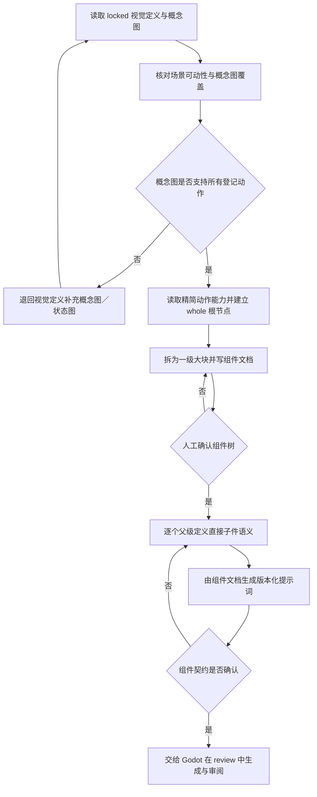

# 中国神话视频角色组件分层拆分与提示词生成工作流

本流程位于“锁定角色视觉定义”和“目标平台资源生成／装配”之间。v10 负责从已确认概念图建立可审查的组件树、分层语义、版本化生成提示词和透明叶子件验收契约；实际中间图与透明叶子候选直接生成到目标实现仓库。

上游：[美术设计与资产工作流](%E5%B7%A5%E4%BD%9C%E6%B5%81-%E7%BE%8E%E6%9C%AF%E8%AE%BE%E8%AE%A1%E4%B8%8E%E8%B5%84%E4%BA%A7.md)及主题绑定视觉配置的角色视觉定义流程。

Godot 下游：[Godot 主入口·资源生成与装配](https://github.com/lseyesl/ancient-tales-godot/blob/main/docs/backend/legacy-vault/%E5%B7%A5%E4%BD%9C%E6%B5%81-Godot.md#%E8%B5%84%E6%BA%90%E7%94%9F%E6%88%90%E4%B8%8E%E8%A3%85%E9%85%8D)。

旧平台无关皮影拆件流程已经删除，不作为本流程的替代入口。

> [!important] 核心原则
> **先写组件文档，再生成提示词；先拆整体为一级大块，再把一个父级大块拆成直接子件。概念图决定外观，精简动作需求决定拆分深度，人工审查决定能否进入下一层。**

> **概念图先由场景可动性需求反推。** 若锁定概念图没有完整呈现某个登记动作的轮廓、接触点、遮挡边缘或物品状态，组件流程必须退回视觉定义补图；不得通过猜测隐藏像素、生成式补画或新增无依据拆件来补救。

> [!important] 按种类拆件与动作最大化覆盖
> **拆件逻辑按角色种类区分，参考可动手办逻辑：人类＝骨架层＋覆盖骨架的可拆装衣服，最大化动作处理；动物＝简单可动；植物＝简单可动。拆件深度由导演镜头下的登记动作需求决定，以“动作×运动链×叶子件”覆盖矩阵最大化覆盖全部登记动作，同时保持最少件数。**
>
> **所有叶子件可以存在备用件**：当前拆件无法完成的动作，直接替换同锚点的备用件完成。备用件必须绑定具体动作需求、与主件同锚点可互换、同等进入契约与审阅；无动作依据的“备用件”按无效装饰拒绝。

> [!danger] 禁止从整体直接跳到叶子件
> 不得把“头、身体、双翼各三段、双腿各三段”等平铺名称一次性交给图像模型生成整套角色。没有父级大块、归属关系、包含／排除项和连接边的提示词，不能进入图像生成。

## 适用范围

适用于需要独立关节、局部替换或分层动画的角色。完整平面剪影、群众远景或不承担关节动作的 B 层角色，可以在视觉定义中明确标记 `flat-sprite` 并跳过本流程。

本流程不负责：

- Godot／Remotion 的 pivot、节点层级、骨骼、动画轨道和预制体；
- 自动证明所有动作都可重建；
- 用数量、Alpha 或文件存在性替代人工视觉判断；
- 在父级未确认时提前生成全套叶子件。

## 正式输入

- 已确认并锁定的角色视觉定义与高保真概念图；
- 锁定分镜中与该角色有关的精简动作能力；
- 该角色及其接触对象的场景可动性简报、概念图／状态图覆盖映射；
- 角色必须保留的身份、比例、配色、纹样与材质；
- 禁止漂移项和权利边界；
- 目标平台对透明格式、尺寸和安全留白的基础要求。

动作能力只用于回答“哪些边界必须独立”。它不替代概念图，也不要求 AI 自动完成结构、轴点或动作重建。

## Vault 默认产物

```text
项目/<主题>/视觉设计/角色/<角色>/
├── <角色>-组件树-v1.md
└── <角色>-组件资产契约-v1.md

项目/<主题>/视觉设计/提示词/角色/<角色>/
└── <parent-component-id>-直接子件-v1.md
```

组件树、一级大块／子件语义和透明叶子验收条件属于平台无关契约。一级大块图、子件审阅板和透明叶子二进制由目标实现仓库拥有，不得在 Vault 与后端保存同内容副本。

装配外观件与运动组件分开管理。皮影角色需要可见关节时，默认只生成一枚独立透明图钉母件供平台复用；图钉不进入组件树的父子运动链，也不预设实例数量与位置。

## 状态协议

组件契约使用[总控统一状态机](%E5%B7%A5%E4%BD%9C%E6%B5%81-%E5%85%A8%E6%B5%81%E7%A8%8B%E6%80%BB%E6%8E%A7.md#%E7%BB%9F%E4%B8%80%E7%8A%B6%E6%80%81%E6%9C%BA)。契约完整后进入 `review`；用户确认后为 `approved`；组件树、提示词和验收规格冻结并可交给后端时为 `locked`。当前层需要升版或缺少关键输入时为 `blocked`；已锁定契约的上游变化时为 `needs-sync`。不再使用 `needs-revision` 扩展状态。

## 总流程



## 阶段一：建立分层组件树

### 1. 从整体到一级大块

根节点必须是完整角色 `whole`。第一层只按主要承力、运动系统和视觉归属拆成一级大块，例如：

```text
CHARACTER-WHOLE
├── HEAD-GROUP
├── BODY
├── ARM-NEAR
├── ARM-FAR
├── LEG-NEAR
└── LEG-FAR
```

鸟类可以把双翼、尾部和双腿分别作为一级大块。第一层不得直接预设“翼三段”“腿三段”；子件数量由动作需求和父级图像共同决定。

### 2. 由动作需求决定拆分深度

- 概念图决定轮廓、比例、配色、纹样和材质。
- 概念图必须先覆盖每个登记动作的关键轮廓、接触点和独立状态；缺少时先退回视觉定义补图，不能把不可见部分当作可任意生成的拆件来源。
- 动作需求决定某个边界是否必须独立。
- 张喙要求头、上喙、下喙分离；头部的 `excludes` 必须同时排除上喙和下喙，两个喙件也不得互相夹带。
- 振翅只证明翅膀需要独立；具体分几段必须在对应整翼父级内继续判断。
- 如果一个父级用单一刚性件即可完成全部登记动作，就停止拆分。
- 不能仅因羽毛、衣纹或颜色变化制造没有动作意义的子件。
- 每个非根组件的 `split_reason` 必须绑定具体镜号与动作证据（或刚性合并理由）；无证据的拆分一律打回。

### 3. 按种类的拆分模板（可动手办参考）

拆件逻辑按角色种类区分，以下模板是起点，不是强制套件；最终结构由动作覆盖矩阵决定。

#### 人类：骨架层＋服装层

拆成两层，两层都是正式契约，分别审阅：

```text
HUMAN-SKELETON（骨架层＝运动层）
├── HEAD（可含颈）
├── TORSO
├── ARM-NEAR / ARM-FAR      # 上臂 → 前臂 → 手
└── LEG-NEAR / LEG-FAR      # 大腿 → 小腿 → 足

HUMAN-CLOTHING（服装层＝可拆装覆盖层）
├── 上衣（袍／褂，分前后片或整体）
├── 下裳／裙（被动遮挡件）
├── 宽袖（若影响臂部动作则独立）
├── 披帛／飘带
└── 头饰／冠帽
```

- 骨架层负责全部关节自由度（肩、肘、腕、髋、膝、踝），是运动链的父级；
- 服装层是**独立覆盖件**：不烘焙肢体、不限制关节，运动时作为从动遮挡件；
- 服装可以**拆装／换装**：同一骨架换服装实现不同外观与动作，换装不改变骨架运动链；
- 服装连接端必须对位骨架锚点（领口对颈、肩线对肩、腰线对腰、袖口对腕）并进入契约；
- 服装不得预打关节孔、不得把肢体像素烘焙进衣料。

#### 动物：简单可动

| 动物类 | 默认运动链 | 段数原则 |
|---|---|---|
| 鸟类／飞行异兽 | 头颈、双翼链、尾扇、双腿链 | 翼按动作证据递归；喙需衔取时只拆下喙 |
| 四足兽 | 头颈、四肢链、尾 | 每腿按行走／奔跑证据递归；尾按摆动需要 |
| 水族／爬行 | 头、躯干分段、鳍／足 | 躯干分段只按弯曲证据，不机械切段 |

#### 植物：简单可动

- 极少关节：茎、叶、花，通常 1–2 个自由度（风摆、弯折、开合）；
- 单株拆为“主茎＋可动叶组＋可动花／果”级别即可，不拆装饰细节；
- 风摆等循环动作由后端复用同一组件，不额外生成多套叶片。

### 4. 动作覆盖矩阵（最大化覆盖）

拆件前从导演锁定分镜提取该角色／物品的**全部**登记动作，建立覆盖矩阵：

| 登记动作（镜号） | 运动链 | 叶子件组合 | 主件或备用件 |
|---|---|---|---|
| 例：抬手（JW2-07） | ARM-NEAR | 上臂＋前臂＋手 | primary |
| 例：握石（JW2-10） | ARM-NEAR | 上臂＋前臂＋握石手备用件 | alternate |

- 每个登记动作必须能由某条运动链的叶子件组合完成；
- 覆盖不足 → 增加拆件或增加备用件；无动作证据的额外拆分 → 打回；
- 覆盖矩阵进入组件契约，作为人工审查的必查项。

### 5. 组件文档必填字段

| 字段 | 要求 |
|---|---|
| `component_id` | 主题内稳定且唯一 |
| `parent_id` | 直接父级；根节点为空 |
| `level` | `whole`、`major` 或 `leaf` |
| `source_region` | 在概念图／父级图中的位置与轮廓范围 |
| `includes` | 本件必须包含的结构 |
| `excludes` | 本件绝对不能包含的相邻结构 |
| `children` | 仅列直接子件 |
| `split_reason` | 哪个动作要求本边界独立；不拆时写明刚性理由 |
| `pose_evidence` | 证明该边界独立的具体姿态／镜号（备用件必填绑定动作） |
| `role` | `primary` 或 `alternate`；备用件与主件同锚点可互换 |
| `alt_of` | 备用件对应主件的 `component_id`；主件为空 |
| `attachment_to_parent` | 与父级连接的位置和方向 |
| `overlap_requirement` | 需要保留或补全的隐藏搭接区 |
| `visual_invariants` | 必须继承的颜色、纹样、材质、比例和朝向 |
| `production_mode` | `extract`、`extend` 或 `generate` |
| `prompt_inputs` | 完整概念图、父级大块图及其具体版本 |
| `review_status` | 当前层人工审查状态 |

`includes` 与 `excludes` 必须使用可目视核对的具体结构，不得只写“正确”“干净”或“符合参考”。

## 目标仓库执行规范

以下阶段二至阶段五是本契约交给 Godot `platform_asset_authoring` 后的强制制作与审阅规范。它们在目标仓库的稳定资产版本路径执行，以 manifest `status: review` 表达候选；不是 Vault `asset_specification` 的二进制产物。

## 阶段二：制作一级大块图

### 像素来源优先级

1. 概念图中完整可见的区域优先通过裁切、蒙版和抠图确定性提取。
2. 被其他结构遮挡但父级必须拥有的区域，使用 `extend` 补全隐藏材料和搭接区。
3. 只有概念图完全没有提供可用像素时才使用 `generate`。

不得为了统一格式重新生成已经清晰可见的大块。生成补全必须同时输入完整概念图和当前父级图，且只能改变文档声明的缺失区域。

全部一级大块的组合必须覆盖完整角色轮廓。近侧结构遮住的远侧翼或肢体不能只保留当前可见残片。

> [!important] 关节孔与图钉分离
> 一级大块和后续叶子件必须保持完整、连续的连接皮片，不生成圆形安装孔、轴孔或关节孔，也不把图钉／铆钉直接画进部件像素。若皮影风格需要显示黄铜关节，只生成一枚独立透明图钉母件，交给目标平台在人工拼装时复用、缩放和定位。装饰性月牙、叶片、长条等已批准镂空仍属于角色纹样，不能误删。

## 阶段三：生成直接子件提示词

### 1. 调用粒度

一次 imagegen 调用只处理一个父级大块，并同时生成该父级的全部直接子件：

- 不逐个叶子件独立生成，以免比例和连接边漂移；
- 不把多个无关父级的所有叶子件塞入一张板；
- 不在本次调用中递归生成孙级组件。

### 2. 每份提示词的固定结构

```text
用途：透明角色组件候选
身份参考：<完整概念图版本与角色不变项>
当前父级：<parent component id、父级图版本与完整轮廓>
直接子件：<准确数量、顺序和 component id>
逐件要求：<每件 includes、excludes、连接端、搭接区>
连续性：<必须延续的比例、纹样、颜色、材质和朝向>
布局：<一行／网格；各件互不接触；完整显示；留白>
背景：<项目规定的纯色色键；主体不得使用该颜色>
禁止：<兄弟件串入、重复、缺件、标签、骨架、操纵杆、阴影、场景>
```

提示词的“禁止”项还必须明确写入：不生成关节安装孔、不内嵌图钉或铆钉。独立图钉母件使用单独提示词生成，不与某个父级的直接子件混排。

备用件提示词规则：

- 备用件与主件同一父级、同锚点、同连接端，提示词必须写明“与 <主件 component_id> 同锚点可互换”；
- 备用件提示词必须绑定动作需求（“本件用于 <镜号><动作>，主件无法完成”），无动作绑定的备用件不生成；
- 服装层组件（人类角色）提示词必须写明“独立覆盖件，不包含肢体像素，连接端对位 <骨架锚点>”。

提示词记录必须保存：

- 组件文档版本；
- 完整概念图和父级大块图路径／版本；
- 最终实际提示词；
- 使用的模型／工具；
- 预期输出文件命名；实际生成后由 Godot manifest 回写相对路径和 SHA-256；
- 返修原因与 supersedes 关系。

提示词文件还必须具有稳定 `prompt_id`、版本和状态。实际生成时，目标仓库 manifest 使用 Vault commit、仓库内提示词相对路径、`prompt_id` 与版本绑定该文件；不得复制提示词正文后在后端独立修改。

不得依靠聊天中未写回记录的临时提示补丁作为正式生成条件。

## 阶段四：透明化与切分

生成源板必须使用均匀纯色色键，各直接子件互不接触。v10 的源板与叶子件直接位于目标实现仓库；历史 Vault 图片维护时，按项目[图像工具说明](https://github.com/lseyesl/ancient-tales-blender/blob/main/docs/archive/vault-tools/README.md)优先使用：

1. `工具/image-tools transparency` 检查背景；
2. `工具/image-tools remove-background` 转换真实 Alpha；
3. 再次运行透明检查；
4. `工具/image-tools split-pieces` 切分单件；
5. 核对组件数量、命名、透明边缘和逐件哈希。

自动检查只能发现数量、背景、Alpha、尺寸和文件问题，不能判断组件语义是否正确。

## 阶段五：逐层人工审查

### 审查节点

1. 完整概念图；
2. 组件树文档（含动作覆盖矩阵）；
3. 一级大块图；
4. 每个父级的直接子件板；
5. 全部透明叶子件汇总（含备用件）；
6. 下游平台实际 bind pose。

父级未通过时禁止生成子级。当前父级返修不得触发其他无关父级重新生成。

### 直接子件板通过标准

- 子件数量与组件文档完全一致；
- 每件只包含自己的结构，不夹带兄弟件；
- 所有子件物理分离，能够独立透明化；
- 子件组合后的可见轮廓能保持已确认父级大块；
- 父级可见纹样、颜色、材质、比例和方向没有漂移；
- 相邻件连接方向正确，隐藏搭接区足以覆盖关节；
- 每个登记动作都能由覆盖矩阵声明的叶子件组合完成；覆盖不足时该动作对应的备用件已补充；
- 备用件与主件同锚点、同连接端，可互换装配；没有无动作依据的备用件；
- 人类角色的服装层为独立覆盖件：不烘焙肢体、不限制关节，连接端对位骨架锚点；
- 没有重复结构、缺件、左右混淆或近远侧串件；
- 没有文字、编号、骨架、操纵杆、阴影或场景元素；
- 连接皮片没有圆形安装孔、轴孔或关节孔，也没有内嵌图钉／铆钉；
- 已批准的装饰性镂空仍保留，没有被误当作关节孔填平；
- 连接处旋转包络检查：登记动作范围内关节不露洞、不穿帮、不裁切，连接端材料足够（可并入装配可行性 dry-run）；
- 透明化后边缘干净，没有色键残留；
- 用户已经对当前父级明确确认。

人工审查是通过结论。自动检查通过不能把 `review` 改为 `approved`。

## 版本与失效规则

- 已确认父级是下一层的固定视觉输入。
- 子件制作只能补文档声明的隐藏搭接区，不能改变父级可见轮廓和纹样。
- 如果子件制作暴露父级错误，父级改为 `blocked` 并建立新版本；旧版保持历史记录。
- 父级升版后，其全部子件、提示词、审阅板和叶子件立即失效，不得混用旧版下游。
- 旧版保留为审阅证据，但不得进入目标平台正式资源。
- 组件契约锁定记录绑定概念图、组件树、提示词和验收规则；平台资源锁定后，由 Godot 制作记录另行绑定完整 commit、透明叶子相对路径／SHA-256 和人工确认版本。

## 交接到目标平台

只有以下契约内容齐全，才允许交给 `platform_asset_authoring` 在目标仓库生成候选：

- [ ] locked 角色视觉定义与概念图；
- [ ] approved 组件树；
- [ ] approved 一级大块和直接子件语义；
- [ ] 每个非叶父级都有版本化提示词与审阅标准；
- [ ] 全部透明叶子件拥有稳定 ID、版本、画布、Alpha 与边缘要求；
- [ ] 已记录目标 `repository_id`、稳定资产路径规则和审阅证据路径规则；
- [ ] 需要可见关节时，独立透明图钉的生成与验收规格已锁定；角色组件不得包含安装孔和内嵌图钉；
- [ ] 动作覆盖矩阵已确认：每个登记动作都能由主件或对应备用件完成；
- [ ] 备用件已绑定具体动作需求、与主件同锚点，并同等进入契约与审阅；
- [ ] 精简动作能力和平台需要验证的 bind pose／关键姿态；
- [ ] 权利状态与生成记录。

目标平台负责按契约生成叶子候选，并可设置自己的 pivot、层级、骨骼和动画。发现组件契约错误时，退回本流程对应父级升版；候选像素与平台参数问题留在平台流程修正，但不得改变已锁定视觉身份。

## 完成检查

- [ ] 拆分从 `whole` 开始，先形成一级大块，没有直接跳到平铺叶子清单。
- [ ] 概念图决定外观，动作需求只决定拆分深度。
- [ ] 已先核对场景可动性与概念图覆盖；所有登记动作、接触、遮挡和物品状态均有可用概念图／状态图，未以猜测或生成式补洞代替概念设计。
- [ ] 拆件逻辑符合角色种类模板：人类为骨架层＋可拆装服装层，动物／植物为简单可动。
- [ ] 动作覆盖矩阵覆盖导演锁定分镜的全部登记动作，每个动作都能由主件或对应备用件完成。
- [ ] 每个组件都有完整必填字段和明确 `includes`／`excludes`。
- [ ] 备用件绑定具体动作需求、与主件同锚点可互换；无动作依据的备用件已拒绝。
- [ ] 服装层为独立覆盖件，连接端对位骨架锚点，不烘焙肢体、不限制关节。
- [ ] 可见像素优先提取，生成只用于缺失结构或搭接补全。
- [ ] 每次 imagegen 只处理一个父级并生成其直接子件。
- [ ] 每个父级都有可追溯的版本化提示词记录。
- [ ] 每一层都经过人工确认，未以自动检查替代视觉判断。
- [ ] 父级升版已正确使下游失效，没有混用版本。
- [ ] 透明叶子件规格包含 Alpha、稳定 ID、版本、文件命名和验收条件。
- [ ] 组件连接区保持连续皮片；关节图钉作为独立装配外观件交付，没有预打安装孔或内嵌铆钉。
- [ ] 目标平台只按锁定组件契约在稳定版本路径生成角色图片，以 manifest 状态审阅和批准，不以目录移动晋升。


> 迁移说明（2026-11-04）：本页专业规范须服从上层 SKILL.md 的现行所有权与存储边界；旧 Vault 写回、旧环境配置与自动提交规则已退役。
