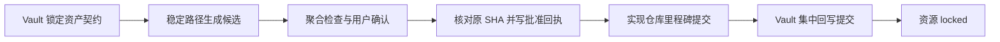

# 中国神话视频跨仓库资产所有权工作流

本流程规定 Vault、实现仓库和未来共享资产仓库之间的二进制资源所有权。该边界最初在历史主题协议 v10 引入，现由本页独立维护；不得再通过比较项目 `config_version` 与主题 `workflow_config_version` 推断所有权。历史主题和历史图片默认继续按原记录读取，只有用户明确授权并建立逐文件迁移索引后才批量移动。

> [!important] 唯一所有者
> 一份生产二进制资源只能有一个版本化事实来源。Vault 负责视觉规格、资产契约和制作追踪；目标实现仓库负责其实际消费的图片、音频、manifest 与平台资源。禁止先把新生产图片写入 Vault，再复制到实现仓库。

## 三类资产

| 类型 | 唯一所有者 | Vault 保存内容 |
|---|---|---|
| 后端专用资源 | 目标实现仓库 | 稳定 ID、规格、仓库标识、相对路径、commit、SHA-256、状态与确认记录 |
| 跨后端共享母件 | 独立共享资产仓库 | 同上，并记录消费它的实现仓库；不得让某个后端仓库充当隐式上游 |
| 概念参考与审阅证据 | 对应主题实现仓库的 `references/`；必要轻量缩略图可留 Vault | 来源、权利、视觉决策、仓库相对路径和 SHA-256；生产原图不因方便审阅而重复归档 |

后端渲染出的静帧、诊断视频和终片默认属于后端输出目录。Vault 只记录输出路径、commit、校验值和审阅结论；确需长期展示时只保留尺寸受控的缩略图或联系表，并明确标为派生审阅证据。

## 稳定路径与状态协议

> [!important] 状态不等于目录
> 新建或实质返修的生产资源从生成开始就使用稳定、版本化的仓库相对路径。`draft`、`review`、`approved`、`locked` 和 `needs-sync` 只写入 manifest 与批准回执；批准不得通过把同一二进制从 `review/` 移到正式目录来表达。

建议的逻辑结构为：

```text
<asset_store_root>/items/<asset_id>/<version>/source/
<asset_store_root>/items/<asset_id>/<version>/parts/
<asset_store_root>/items/<asset_id>/<version>/runtime/
<audit_root>/<package_id>/
```

目标仓库可以按平台惯例调整层级名称，但同一资产版本的生产路径在第一次进入审阅后必须稳定。`audit/` 已经是审阅证据根，包目录直接使用 `<package_id>/`；不得再增加与 manifest `review_status` 重复的 `review/` 生命周期层。历史 `review/` 路径只按既有记录解释，不再用于新包。

每项资产至少有：`asset_id`、`version`、稳定相对路径、`sha256`、`status`、`review_status`、来源契约和包 ID。批准回执记录批准时的内容哈希；只改变状态时不得重新编码或重建二进制。

## 直接生成协议

1. 在 Vault `项目/<项目>/视觉设计/` 锁定视觉定义与资产契约；正式提示词使用已锁定版本，候选补词按下节保存。先读取项目配置中的 `project_id`、`story_id`、`visual_profile` 和 `visual_profile_version`；契约包含这些身份、稳定 `asset_id`、`prompt_id`／版本、类别、镜号、视觉不变量、画布／Alpha、允许变换、权利状态和目标 `implementation_profile`。
2. 读取目标实现仓库最近的 `AGENTS.md`，保护现有工作树，并解析该实现配置登记的仓库标识、稳定资源根和审阅证据根。
3. 将候选图片直接生成或确定性派生到目标实现仓库的稳定版本路径；不得在 Vault 建立同内容生产副本。
4. 在目标仓库生成 manifest、SHA-256、诊断静帧／片段并运行最窄验证。自动验证不能代替用户确认。
5. 用户确认后先核对被审 SHA-256；内容未变时只更新 manifest 状态、批准回执和必要索引，不移动资源、不重建审阅证据。内容已变则退回审阅并建立新版本或新候选哈希。
6. 候选 checkpoint 按需创建且不强制 Vault 回写。正式批准先提交目标实现仓库，再在 Vault 按资产包或阶段里程碑一次性回写精确引用并提交；必要提交均成功后资源才是 `locked`。

## Vault 外部资源引用

### 候选提示词与正式绑定

在不改变已锁定视觉身份、资产契约和动作语义的范围内，候选试验可在所有者仓库现有生成记录保存实际完整提示词（包括补词）、内容 SHA-256、参考输入身份、模型／参数及输出哈希，并引用原 Vault 提示词版本。每次变体与输出一一对应，不能仅记录聊天摘要或覆盖旧输出的来源记录。

正式送审前，将选中候选实际使用的完整提示词原文保存到 Vault 新版本；核对正文内容哈希一致后集中提交，后端补齐该 Vault commit 与相对路径。无需只为补齐追踪重跑生成。之后才执行用户批准、实现仓库提交和 Vault 里程碑回写；提示词预提交不表示资产获批，也不能循环引用尚未存在的后端提交。

候选记录是生成事实快照，不能作为另一套独立维护的正式提示词源；锁定后仍以 Vault 为权威。改变视觉身份、动作语义或契约必须先走上游变更，不适用候选补词简化。若后端检查器尚不支持候选来源字段，保留生成记录并如实保持候选，送审前补齐原正式字段，不绕过检查。

### 正式引用字段

每个已确认资源或资源包至少记录：

```yaml
asset_id: <stable-id>
prompt_id: <stable-prompt-id>
prompt_version: <version>
prompt_vault_commit: <full-vault-commit-sha>
prompt_vault_relative_path: projects/中国神话视频/项目/<项目>/视觉设计/提示词/<file>.md
project_id: <stable-project-id>
story_id: <stable-myth-id>
visual_profile: <profile>
visual_profile_version: <version>
repository_id: <registered-repository-id>
repository_commit: <full-commit-sha>
repository_relative_path: <path-within-repository>
sha256: <file-content-sha256>
implementation_profile: <profile>
status: locked
confirmed_at: YYYY-MM-DD
```

禁止把本机绝对路径当作可移植身份。绝对路径是当前环境的定位信息，远端 URL 是仓库恢复信息，二者统一由[依赖仓库注册表](https://github.com/lseyesl/ancient-tales-blender/blob/main/docs/archive/vault-environment/%E4%BE%9D%E8%B5%96%E4%BB%93%E5%BA%93%E6%B3%A8%E5%86%8C%E8%A1%A8.md)维护；正式资产绑定仍使用 `repository_id + repository_commit + repository_relative_path + sha256`。

> [!danger] 跨风格项目禁止复用
> `story_id` 相同不构成资源复用许可。生成或接入前，后端 manifest、资源根、提示词、资产契约和审阅证据的 `project_id`、`visual_profile` 与 `visual_profile_version` 必须和当前项目配置逐项一致；不一致时停止。要制作另一风格，创建新的 Vault 项目与新的后端 `<project_id>` 根，不复制、引用或覆盖原项目的生产资源。

首次进入、恢复任务或仓库／环境配置变化时必须同时验证；同一会话未变化的定位结果可复用：

1. `repository_id` 能在注册表中解析；
2. `resolve_environment.py` 从当前环境 profile 解析出的 `local_path` 指向当前 Git 工作树；
3. 实际 fetch／push remote 与注册表中的远端仓库身份一致；
4. 若配置路径不存在，能使用注册表的 `canonical_clone_url` 在新环境恢复仓库；
5. SSH alias 只属于当前环境，不能作为唯一迁移依据。

## 双仓库提交顺序



- 实现仓库提交失败：Vault 不得写成 `approved` 或 `locked`。
- Vault 提交失败：实现资源保留已提交状态，但正式下游不得绑定，直到追踪记录补齐。
- 任一仓库存在无法安全拆分的混合改动时停止提交，不得扩大暂存范围。
- 候选完成不是强制双仓库节点；除非需要跨会话交接，不为 `review` 状态单独提交 Vault。
- 批准不改变内容哈希时，审阅图、工程文件和媒体继续复用原证据，不因状态变化重建。

## 新增实现仓库

新增后端时，在[项目配置](%E5%B7%A5%E4%BD%9C%E6%B5%81-%E9%A1%B9%E7%9B%AE%E9%85%8D%E7%BD%AE.md)登记新的 `implementation_profile`，并至少提供：

- `repository_id`；
- 依赖仓库注册表条目，包括稳定仓库 ID、remote 名称和规范克隆 URL；
- `环境配置.json` 中至少一个可解析的环境 profile，包括本机路径、配置 remote 和后端 executable 候选；
- 一个活动后端主入口，以及 `platform_asset_authoring`、`visual_prototyping`、`video_implementation` 三个锚点路由；
- 稳定资源根、审阅证据根和输出根的仓库内相对路径规则；
- manifest、聚合校验、状态批准和提交规则；
- 与视觉配置的兼容集合。

不得把新实现仓库嵌入 Vault，也不得为了让 Obsidian 能预览而复制全量生产资源。

## 历史兼容

- 本协议 v2 对所有主题在 2026-08-17 之后新建或实质返修的资产版本生效；锁定在旧项目配置的主题无需仅为采用稳定路径协议新建 profile 配置版本。
- 既有 `review/` 与正式目录中的资产保持原路径和原 commit，不批量迁移；旧主题记录中的候选根／正式根只解释已有文件，不能要求新资产继续使用目录移动晋升。
- 现有 Vault 图片、source manifest 和历史导入副本默认不移动；用户明确授权历史迁移时，必须先建立完整映射、复用目标同哈希文件、校验新增目标副本，再删除 Vault 图片并改写引用。
- 不参与 runtime 的历史概念图、审阅图和源板进入主题实现仓库的 `references/vault-visual-reference/`，不得伪装成已批准 runtime 资产。
- 历史迁移索引至少保留旧 Vault 路径、目标 `repository_id`、仓库相对路径、SHA-256、迁移日期和提交待锁定状态。
- 历史迁移不自动重写 Git 历史；如需缩小 `.git`，必须另行授权历史重写和所有克隆协同迁移。
- 旧主题继续按其锁定配置读取。
- 采用 v10 的新主题，或用户明确升级到 v10 的主题，新生成和替换的生产资源必须遵守直接生成协议。
- 旧资源需要返修时建立新版本；新版本写入目标实现仓库，Vault 历史路径只作为旧版本证据保留。

## 完成检查

- [ ] 每项生产二进制只有一个版本化事实来源。
- [ ] Vault 没有新建与后端内容相同的生产副本。
- [ ] 新资源从首次审阅起使用稳定版本路径，生命周期状态不依赖目录。
- [ ] 确认前核对原 SHA；确认后没有为纯状态变化移动或重建二进制。
- [ ] Vault 记录包含仓库标识、完整 commit、相对路径和 SHA-256。
- [ ] 后端 manifest、资源根、提示词和资产契约的 `project_id`、`visual_profile` 与版本和当前项目完全一致。
- [ ] 候选 checkpoint 按需创建；正式批准由实现仓库提交先于 Vault 里程碑回写。
- [ ] 历史资产未被隐式迁移或删除。


> 迁移说明（2026-11-04）：本页专业规范须服从上层 SKILL.md 的现行所有权与存储边界；旧 Vault 写回、旧环境配置与自动提交规则已退役。
