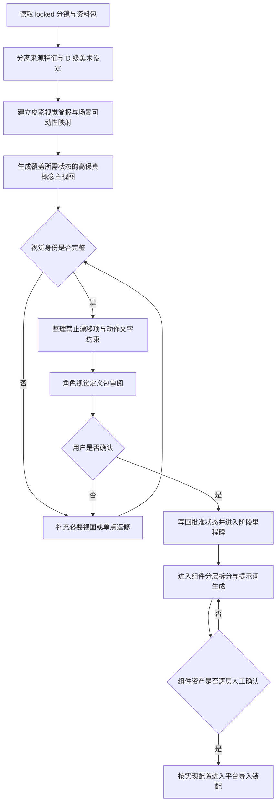

# 中国神话视频皮影角色视觉定义工作流

本流程是 `visual_profile: shadow_puppet` 的概念设计入口。它把来源支持的角色特征和项目美术选择整理为可跨实现平台读取的**角色视觉定义包**，只回答“角色是谁、长什么样、哪些特征不能漂移”，不提前决定 Godot、Remotion 或其他平台如何拆件、绑定和运动。

父流程：[美术设计与资产工作流](%E5%B7%A5%E4%BD%9C%E6%B5%81-%E7%BE%8E%E6%9C%AF%E8%AE%BE%E8%AE%A1%E4%B8%8E%E8%B5%84%E4%BA%A7.md)。

配置入口：[项目工作流配置](%E5%B7%A5%E4%BD%9C%E6%B5%81-%E9%A1%B9%E7%9B%AE%E9%85%8D%E7%BD%AE.md)。

> [!important] 核心原则
> **批准对象是一份角色视觉定义包，不是孤立的一张效果图。平台专用透明单件、隐藏重叠、关节层级、锚点、骨骼和动作范围不属于本流程。**

## 启用条件

只有当前主题绑定的 `visual_profile` 为 `shadow_puppet` 时，才默认执行本流程。项目默认配置只影响新主题；主题一旦绑定具体视觉配置和版本，不随项目默认值自动改变。

正式输入：

- `locked` 的导演方案或分镜；
- 主题级 `主题工作流配置-v<版本>.md`；
- 资料包中来源支持的外形、颜色、身份与禁用误读；
- 角色在锁定分镜中的出场范围和主要表演需求；
- 父流程中该角色、所接触动物／植物／物品和相关景物的场景可动性简报；
- 当前主题绑定的 `visual_profile` 与版本；
- 画幅、角色尺度和整片视觉圣经约束。

## 默认产物

```text
projects/<project_id>/content/视觉参考/角色/<角色>/
├── <角色>-角色视觉定义-v1.md
├── <角色>-皮影概念主视图-v1.png
└── 视觉定义-v1/
    ├── 侧面或背面参考.png       # 仅在主视图无法定义时需要
    ├── 纹样与材质细节.png       # 仅在需要时创建
    └── 表情或状态参考.png       # 仅在分镜确有需要时创建
```

不为了套模板生成无用途视图。主视图已经清楚定义的内容不重复制作；被遮挡区域、背面纹样或关键状态会影响平台生成时，才补充相应视图。

## 视觉定义包必填内容

每份 `<角色>-角色视觉定义-v<版本>.md` 至少记录：

| 内容 | 要求 |
|---|---|
| 视觉身份 | 年龄感、物种／人物类型、整体比例和主轮廓 |
| 来源特征 | A／B／C 级证据支持的外形与颜色，链接到具体资料 |
| 美术设定 | 服饰、发型、纹样、配色等 D 级项目选择 |
| 材质语言 | 皮革透光、镂刻密度、边缘、有限识别色和幕布关系 |
| 稳定视图 | 主标准视图及确有需要的侧／背／局部细节 |
| 禁止漂移项 | 不能改变、增加或现代化的识别特征 |
| 动作约束 | 只记录分镜所需动作能力、接触关系和必须保持的轮廓 |
| 概念图可动性覆盖 | 每个登记动作、接触、遮挡和状态替换对应的高保真主视图／姿态图；不可由概念图支持的需求必须先返修 |
| 权利状态 | 项目生成、外部参考、授权边界和发布审计状态 |

## 总流程



## 生成输入规则

### 允许作为视觉输入

- 同一角色已经批准的高保真概念图；
- 来源明确且只用于造型研究的服饰、器物、动物或材质参考；
- 保持完整角色外观的高保真姿态变体；
- 当前视觉圣经、色彩脚本和文字化动作要求。

### 禁止作为默认视觉输入

> [!danger] 禁止简易骨架主导生成
> **简易骨架、火柴人、关节线、低保真结构色块、结构占位件、编号拆件板和调试骨骼不得作为默认 AI 图像生成输入，也不得作为角色视觉批准对象。**

- 不通过提示词声称“降低骨架权重”来绕过本规则；生成工具未提供可验证的独立权重控制时，任何骨架参考都视为高漂移风险；
- 若未来某个工具确实支持可验证的独立控制权重，只能在该工具的适配说明中作为默认关闭的试验选项，不得成为通用流程门槛；
- Godot 内部的 pivot、骨骼和关节连线只服务工程调试，不得导出回本流程，也不得进入下一轮美术生成。

## 动作需求的表达方式

本流程不制作动作骨架图。动作约束来自锁定分镜，并以以下方式记录：

- 动作能力名称，例如行走、抬手、衔取、振翅；
- 主动部位、接触对象和动作方向；
- 必须保持的角色轮廓与识别特征；
- 最大／最小姿态的文字描述；
- 对应镜号和用途；
- 禁止的变形、穿插和误读。

动作图若确有必要，必须是保持批准造型的高保真角色姿态图，只表达外观和目标轮廓，不叠加骨架、关节线或拆件编号。最终动作标准由目标平台使用真实角色资源输出的动作测试决定。

概念主视图和补充姿态图必须在生成前由场景可动性简报反推：凡是角色需要抓取／释放物品、触碰植物、被景物遮挡、改变朝向或出现轮廓明显变化的动作，概念图必须完整显示相关接触区、主体轮廓和必要状态。不得先生成一张美观但手、衣物、道具或交互对象相互烘焙的全景图，再要求组件／平台流程从不可见区域补画可动部分；应先补充对应的高保真姿态或物品状态图。

## 确认节点

用户确认视觉定义包时，至少检查：

- 来源识别特征没有被 D 级设定替换；
- 主视图和必要补充视图能够稳定定义角色；
- 比例、色彩、材质、纹样和年龄感一致；
- 禁止漂移项足以约束后续平台生成；
- 动作要求没有提前指定平台拆件或绑定方法；
- 每项登记动作、接触、遮挡和状态替换都有可用于后续拆件／生成的概念图覆盖，不存在把未来必动部分烘焙进不可分离构图的情况；
- 权利状态允许进入制作。

确认后写入 `approved_at`、`approved_by` 和 `locked_at`，把该具体视觉定义版本设为 `locked`，完成必要检查并纳入当前阶段里程碑提交。只有里程碑提交成功后[角色组件分层拆分与提示词生成工作流](%E5%B7%A5%E4%BD%9C%E6%B5%81-%E8%A7%92%E8%89%B2%E7%BB%84%E4%BB%B6%E5%88%86%E5%B1%82%E6%8B%86%E5%88%86%E4%B8%8E%E6%8F%90%E7%A4%BA%E8%AF%8D%E7%94%9F%E6%88%90.md)才可开始；不必等待整片门槛四，也不为同批定义包逐图创建提交。

## 返修边界

- 组件边界、归属、隐藏搭接或叶子件像素失败：回到角色组件流程对应父级升版；
- pivot、节点层级、骨骼或动作范围失败：留在目标平台导入装配流程返修；
- 必须改变角色轮廓、核心比例、服装、纹样或识别特征：本流程建立新视觉定义版本；
- 新版本不得覆盖已批准版本，既有平台资源继续绑定原版本，直到明确迁移。

## 完成检查

- [ ] 已绑定 locked 分镜、资料包和主题视觉配置版本。
- [ ] 来源特征与 D 级美术设定已经分开。
- [ ] 主视图及必要补充视图足以定义角色身份。
- [ ] 已记录禁止漂移项和文字化动作能力。
- [ ] 概念图由场景可动性简报反推，覆盖全部登记动作、接触、遮挡与状态变化；无法实现的构图已在概念阶段返修。
- [ ] 没有生成平台拆件、骨架、锚点或结构占位件。
- [ ] 没有把简易骨架、关节线或低保真结构图作为 AI 生成输入。
- [ ] 用户确认记录和独立 Git commit 已完成，具体视觉定义版本为 `locked`。
- [ ] 下游明确先进入角色组件分层拆分，再进入目标平台导入装配。
