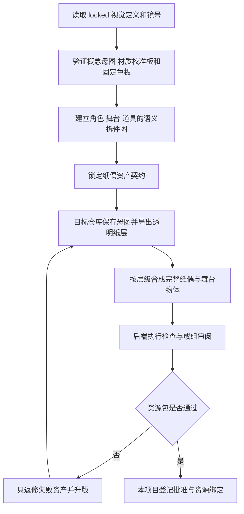

# 中国神话视频纸偶小剧场静态资产工作流

本流程是 v10 `visual_profile: paper_theater` 的 `asset_specification` 入口，负责从已锁定纸偶视觉定义建立并锁定完整静态资产契约。它定义关键完整角色姿态、完整道具状态、纯色背景幕和独立舞台物体的稳定 ID、生成规格和验收条件；生产图片直接由目标实现仓库拥有。

配置入口：[项目工作流配置](%E5%B7%A5%E4%BD%9C%E6%B5%81-%E9%A1%B9%E7%9B%AE%E9%85%8D%E7%BD%AE.md)。

上游：[纸偶小剧场视觉定义工作流](%E5%B7%A5%E4%BD%9C%E6%B5%81-%E7%BA%B8%E5%81%B6%E5%B0%8F%E5%89%A7%E5%9C%BA%E8%A7%86%E8%A7%89%E5%AE%9A%E4%B9%89.md)。

下游由主题绑定实现配置的 `platform_asset_authoring` 解析；不得在本视觉流程中写死某个后端入口。

> [!important] 核心原则
> **资产契约一经确认，后端必须按“场景可动性需求 → 概念母图／状态图 → 语义拆件 → 纸层去背 → 纸偶合成”制作。概念图必须先证明对象的镜头可动性，不能跳过母图直接画轮廓，也不能在 项目内容区 与后端各保存一份生产图。**
>
> 场景母件必须在生成时就是可辨认的纸片；不得先接受普通插画，再把“变得像纸”留给后端滤镜。

## 正式输入

- locked 的纸偶小剧场视觉定义版本；
- locked 的角色完整姿态、场景景层和道具状态定义；
- 父流程的场景可动性简报，以及每个对象的“镜头需求 → 概念图覆盖 → 资产单位”映射；
- locked 分镜及全部对应镜号；
- 视觉圣经、色彩脚本、目标规格和安全区；
- 资产稳定 ID、权利状态和提示词／派生来源；
- 主题绑定的 `paper_theater` 配置版本。

缺少具体视觉定义版本时只能制作候选，不得写入正式资产 manifest。

## 项目内容区 默认产物

```text
projects/<project_id>/content/素材清单/
└── 纸偶静态资产契约-v<版本>.md

projects/<project_id>/content/视觉设计/提示词/
├── 角色/
├── 场景/
├── 道具/
└── 特效/
```

项目内容区 只保存稳定 ID、视觉定义链接、`视觉设计/` 中的版本化提示词／派生规则、验收条件、权利和后端追踪字段。候选与正式图片、manifest、代码路径、Composition 和渲染输出保存在真实后端工程，不复制回 项目内容区。

## 资产单位

| 类型 | 最小正式单位 | 不包含 |
|---|---|---|
| 角色 | 姿态集中一个完整角色姿态／朝向／表情状态 | 肢体拆件、关节孔、骨骼、pivot |
| 背景幕 | 一张白／暖白或黑／近黑的统一纯色纸幕 | 山海、建筑、天气和其他完整场景细节 |
| 舞台物体 | 一座山、一组树、一段岸线、一片云或其他可独立摆放的完整纸片 | 烘焙成整张场景图的多个物体 |
| 海浪 | 一排可重复实例化的完整海浪纸片 | 整张大海背景、单矩形水面或只有一排的波形 |
| 道具 | 一个完整道具状态 | 抓取骨骼、约束节点 |
| 特效 | 静态纸片、纹理、遮罩或完整状态图 | Remotion 时间参数和组件代码 |
| 排版图形 | 不可本地化的装饰、印章或书法图形 | 可本地化正文和字幕 |

“完整”指 runtime 资产可以作为一个独立视觉对象进入舞台。制造阶段允许按语义拆成纸层并重新合成；整体平移、缩放、旋转、显隐、遮罩和完整姿态替换不要求把制造拆件暴露给 runtime。

## 稳定编号与 manifest

建议 ID 保持美术需求前缀，并增加状态语义：

```text
CH-<character>-<pose-set>-<pose>-<view>
BG-CURTAIN-<light-state>
SC-<scene>-<object>
WV-<scene>-<row-variant>
PR-<prop>-<state>
FX-<effect>-<state>
TX-<graphic>
```

每项正式资产至少记录：

| 字段 | 要求 |
|---|---|
| `asset_id` | 主题内唯一，后续不得复用给不同视觉内容 |
| `paper_material_profile` | 所有纸偶资产必填；指向已通过的纸片材质校准板与版本 |
| `paper_style_audit` | 结构化 AI 视觉检查记录路径、检查模型／版本和最终 pass／fail |
| 类型／名称 | 角色姿态、纯色底幕、舞台物体、海浪排、道具、特效或图形 |
| `pose_set_id`／`pose_role` | 角色姿态资产必填；记录所属姿态集与中立、预备、发力、滑翔、振翅上扬、振翅下压等动作阶段 |
| visual definition | locked 视觉定义 wikilink 与版本 |
| 对应镜号 | 使用范围与必要状态 |
| 文件身份 | 生成前记录目标 `repository_id`、稳定版本路径和审阅包；锁定后记录同一路径、bucket URI、资源版本与批准时 SHA-256 |
| version | 资产版本 |
| sha256 | 锁定文件内容哈希 |
| canvas | 像素尺寸、色彩空间和透明度要求 |
| contact intent | 脚底、地面、手持物或遮挡意图；不写平台 pivot |
| safe transform | 允许的整体缩放、倾斜、翻转和裁切边界 |
| motion intent | 允许与该资产组合的水平移动、升降、上下浮动、俯仰、震动或错相运动语义；不写 Remotion 数值 |
| concept motion coverage | 本资产覆盖的镜头可动性条目、对应概念母图／状态图和不可用时的返修边界 |
| repeat intent | 海浪、雨滴等重复物体的实例化语义；记录数量／密度、错位、缩放、旋转、速度与景深是否由运行时控制，不写平台数值 |
| rights | 自制／生成／授权及限制 |
| status | `draft`、`review`、`approved`、`locked`、`blocked`、`needs-sync` |
| replaces | 被替代的资产版本 |

平台导入路径、CSS `transform-origin`、React 组件、Z 层枚举和 Composition ID 不进入平台无关 manifest。

## 制作流程



### 1. 建立最小资产清单

- 先验证 locked 视觉定义中的 `paper_material_profile`、材质校准板、固定色板、提示词版本和场景可动性映射；缺少其中任一项，或概念图未覆盖登记的可动状态／接触／遮挡时，停止批量生成；
- 从 locked 分镜反查每个镜号需要的关键完整姿态、道具状态、独立舞台物体和海浪排；
- 多个镜头可复用同一资产时只建立一个稳定 ID；
- 动态差异能够由整体变换或显隐表达时不新增图像；
- 只有轮廓、朝向、接触或剧情状态明显改变时才新增完整状态；
- 不因生成方便把完整角色拆成肢体，也不因“以后可能用”扩张姿态包。
- 主要角色先建立 `pose_set_id`，再从实际动作节拍选出少量可读的关键完整姿态；不得只交付一个姿态后要求后端用水平平移冒充全部动作。
- 飞鸟姿态包原则上包含滑翔、振翅上扬和振翅下压；衔石、衔枝、投下等会改变轮廓或接触关系的状态另建完整姿态。
- 场景只建立统一纯色底幕和可识别的独立舞台物体，不建立含完整山海或天气细节的 16:9 背景图。
- 每个海景至少建立一排可重复的海浪母件，并在舞台重建规则中要求至少三个独立实例层；需要明显轮廓差异时可以提供多种浪排母件。
- 雨、雪、落叶等大量重复特效优先生成“一个最小可辨识纸片单元”；雨只能交付单个雨滴母件，不得生成雨幕或多雨滴组。密度、位置、速度、起始错相、缩放、旋转、透明度和 Z 层由平台运行时逐实例控制。

### 2. 规定候选生成契约

本节是目标实现仓库 `platform_asset_authoring` 的强制生成规范。执行生成时，输出必须直接写入实现配置登记的稳定资产版本路径，并由 manifest 标记 `review`；不得先在 项目内容区 生成再复制。

生产顺序不可交换：

1. `concept-master/`：保存已确认高保真概念母图与拆件母板；
2. `parts/`：从母图直接切出或在母图强约束下派生的透明纸层，每层保留来源区域、母图哈希和派生说明；
3. `assembled/`：按语义层级、遮挡和搭接将纸层确定性合成为完整角色姿态、道具状态与舞台物体；
4. `runtime/`：只从已通过合成审阅的资产导出，不重新描边、不矢量化、不用 CSS／SVG 重新造型。

禁止把代码原生轮廓 SVG、几何色块、火柴人、占位剪影、自动描摹矢量或后加纸纹的普通插画列为 `assembled`／`runtime` 生产资产。SVG 仅可承载切割蒙版、碰撞／布局辅助和诊断框，并必须在 manifest 标记 `non_visual_helper`。

- AI 生成必须绑定 locked 视觉定义、身份不变量、资产 ID、镜号和提示词版本；
- AI 生成还必须绑定对应的场景可动性条目。人物、动物、植物、道具、景物或特效需要独立运动、持取／衔取、接触、遮挡、开合、掉落、破损或状态替换时，候选必须从已覆盖这些条件的概念图／状态图派生；不得从一张不可分离的完整场景图临时抠取或补画必动部分；
- 所有 AI 生成的角色完整姿态、场景物体、海浪、道具和纸片特效都共用以下正向材质母句；下列完整模板以场景物体为例，对象提示词只补充形状、色彩、朝向与舞台用途：

```text
2.5D cardstock puppet, flat rigid pieces, uniform paper thickness,
visible cut edges, layered construction, 3/4 perspective,
isolated handmade matte cardstock paper cutout, flat layered color shapes,
subtle visible paper fibers, slightly irregular hand-cut edge,
thin pale paper-core rim, no baked cast shadow, single object only,
no landscape, no character, no text, no frame, no photorealism,
no fully volumetric 3D render, no rounded solid volume, no plastic sticker,
no full-frame background
```

该母句中的 2.5D 仅指“二维剪影＋Z 轴纸板厚度＋多层平行纸片”：正面造型保持扁平刚性，3/4 视角用于暴露纸板侧缘、切边和层叠关系，不得扩展为圆润雕塑、实体玩具或自由曲面 3D。所有同包对象使用同一纸张厚度标尺；远近变化只改变整体尺度，不改变相对纸厚。

生成角色完整姿态时保留从 `2.5D cardstock puppet` 到 `single object only` 的全部正向材质词，并移除场景专用的 `no character`；生成其他类别时也只能调整与主体类型冲突的隔离词，不得删除统一纸厚、可见切边、多层构造或 3/4 透视。

- 生成服务能可靠输出透明图时直接要求透明背景；否则使用主题批准的纯色色键背景，再通过项目统一工具确定性去背；
- 批量生成前先用山体、植被、岸线、海浪和天气片各一件组成材质校准板；任一类别缺少可见 Z 轴纸厚、切边或多层构造，或呈现普通插画、塑料贴纸、圆润实体 3D 体积感时，整批不得开始；
- 海浪提示词必须是“单独一整排横向海浪纸片”，不能请求 ocean、seascape 或完整海面；
- 雨滴提示词必须明确 `exactly one isolated raindrop`、`no rain curtain`、`no multiple drops`；生成结果若含多条雨丝，即使透明度和纸片材质合格也必须判定为粒度失败；
- 从已确认候选导出透明母件时只进行确定性裁切、蒙版、色彩和画布处理；
- 角色纸层至少按头脸／发冠、躯干、前后手臂、前后腿、服装覆片和独立道具建立语义边界；最终可以合成为少量完整姿态 PNG，不强制 runtime 骨骼化；
- 每个合成资产必须保存装配清单：部件 ID、源母图、层序、搭接区、缩放／旋转／位移、画布和输出 SHA-256；
- 历史图像需要透明化或检查时，先读取[项目图像工具说明](https://github.com/lseyesl/skills/blob/main/skills/shadow-puppet-part-splitter/SKILL.md)并使用统一入口；
- 不允许通过生成式填充改变已确认轮廓后仍沿用原资产版本；
- 无法可靠从审阅图提取母件时，建立新候选版本并重新审阅。

### 3. 自动检查

每项候选至少检查：

- 文件存在、格式可读、尺寸和色彩空间符合主题配置；
- 需要透明背景的角色、道具、舞台物体和海浪排具有有效 Alpha；
- 可见像素不为空，边缘没有明显底色污染、硬锯齿或被裁切；
- `asset_id` 唯一，文件名、版本和 manifest 一致；
- SHA-256 已记录；
- 同一角色姿态包的比例、材质、服饰、纹样和色彩没有漂移；
- 每个生产资产存在 `concept_master_id` 与 `assembly_manifest`，并能从输出反查全部透明纸层；
- 合成预览与母图在身份、纹样、纸张纹理和色彩上连续，没有退化为轮廓图或几何占位；
- `paper_material_profile` 存在且与校准板、提示词版本和同包其他资产一致；
- 每件场景物体同时可见二维剪影、统一 Z 轴纸厚、多层纸片、3/4 透视下的切边、平面纸色块、轻微纸纤维和略不规则手切边缘；不得只靠全局纸纹或投影获得纸片感；
- 除底幕外每个文件只有一个独立主体和透明背景，不含完整场景矩形、角色、文字或边框；
- 母件没有写实明暗、圆润连续的实体 3D 体积、塑料贴纸质感或方向性烘焙投影；允许且必须保留有限、统一的纸板 Z 轴厚度；
- 同一姿态集在替换时视觉中心、脚底、喙部或持物接触的连续意图一致；
- 每个登记的可动状态、接触点、遮挡边缘与独立运动对象都能追溯到相应概念图／状态图和资产单位；概念图缺口不得由后端自由创作补齐；
- 背景幕为统一纯色，不包含可识别场景细节；
- 独立舞台物体在目标画幅中能确定性重建批准构图；
- 海景重建至少使用三排独立海浪，并能形成前后遮挡和错相运动；
- 可本地化文字没有烘焙进图像。

自动检查通过不等于视觉资产已确认。

AI 视觉检查必须输出结构化结果，不能只写“看起来像纸片”：

```yaml
paper_style_audit:
  isolated_single_subject: pass
  two_dimensional_silhouette: pass
  visible_z_axis_paper_thickness: pass
  uniform_paper_thickness: pass
  layered_paper_construction: pass
  three_quarter_perspective: pass
  flat_paper_color_blocks: pass
  subtle_paper_fibers: pass
  irregular_hand_cut_edge: pass
  thin_paper_core_rim: pass
  no_baked_directional_shadow: pass
  no_full_scene_composition: pass
  no_plastic_photorealistic_or_3d_look: pass
  overall: pass
```

任一子项为 `fail` 时 `overall` 必须为 `fail`，资产返回生成／派生阶段；不得用平均分让明显不合格的纸片线索互相抵消。AI 检查记录需保存检查模型／版本、输入资产哈希、提示词版本与失败理由，方便只返修失败母件。

### 4. 成组审阅

为了减少人工节点，按可解释的资产包审阅：

- 一个角色的全部正式姿态与朝向组成一个角色姿态包；
- 一个场景的纯色底幕、独立舞台物体和海浪排组成一个场景包；
- 同一叙事功能的道具状态组成一个道具包；
- 特效纹理和排版图形按功能成组。

审阅包还必须列出场景可动性覆盖表：逐项标明镜号需求、概念图／状态图、候选资产和验证方式。任何“概念图里无法完整看到、却要求在镜头中独立运动”的部分均为 `fail`，应退回视觉定义阶段补图或重设构图。

审阅包至少包含资产 ID、`paper_material_profile`、透明母件缩略图、统一尺度材质接触表、目标画幅合成预览、对应镜号、版本和变更说明。接触表必须能直接比较纸纤维、手切边缘、纸芯和色板连续性；只有高风险漂移或单项返修时才拆成独立确认节点，不默认逐图确认。

用户确认资产包后，当前制作仓库核对批准对象与哈希，登记回执和绑定。内容未变时复用原审阅证据，不移动或重建二进制；内容变化退回 review。制作媒体存 HF，用户明确要求时才提交本项目的文本、代码和索引。

## 版本与失效

- 替换像素内容、轮廓、姿态、朝向、材质、色彩或画布语义必须建立新资产版本；
- 只修正文档拼写且不改变文件内容，可以原版本记录；
- 资产包部分失败时只升版失败资产及受其影响的包，不重新生成已锁定资产；
- visual definition 发生影响性变化时，对应资产标为 `needs-sync`；
- 后端正式资源不得原地覆盖冒充旧版本；发现需要改变视觉契约时必须退回本流程，纯平台实现问题在后端建立新资源版本。

## 交接到 Remotion

只有以下内容齐全，才能进入 `platform_asset_authoring`：

- [ ] 主题工作流配置与 locked 分镜；
- [ ] locked 纸偶视觉定义版本；
- [ ] 已通过的纸片材质校准板、`paper_material_profile` 和提示词版本；
- [ ] 已确认的角色姿态、纯色底幕、独立舞台物体、海浪、道具及必要特效契约；
- [ ] 稳定 `asset_id`、目标仓库标识、稳定资产路径规则、审阅证据路径和版本要求；
- [ ] 对应镜号、接触意图、允许整体变换和禁止项；
- [ ] 权利状态；
- [ ] 资产契约确认 commit。

Remotion 按锁定契约直接生成候选、建立后端路径映射、校验并测试整体运动。它不得拆肢体或绕过视觉定义改变角色身份。

## 完成检查

- [ ] 所有正式资产都能追溯到 locked 纸偶视觉定义和镜号。
- [ ] 所有正式资产都能追溯到概念母图、透明纸层和装配清单；没有跳过母图的代码轮廓生产资产。
- [ ] 所有场景母件都能脱离舞台独立辨认为“二维剪影＋Z 轴纸厚＋多层纸片”的 2.5D cardstock puppet，并通过材质接触表检查；没有无厚度插画、普通插画叠纸纹、塑料贴纸或圆润实体 3D 资产。
- [ ] 每件场景母件都有绑定文件哈希和检查模型版本的结构化 `paper_style_audit`，所有硬子项均为 `pass`。
- [ ] 角色以完整静态姿态交付，没有组件树、关节、骨骼、pivot 或 bind pose。
- [ ] 主要角色以关键完整姿态集交付，并记录 `pose_set_id`、动作阶段、替换节拍和对齐意图。
- [ ] 人物、动物、植物、道具、景物和特效的概念图均已先按场景可动性需求设计；每个登记的可动状态、接触、遮挡和独立对象都有概念图覆盖与对应资产单位。
- [ ] 背景幕只有统一纯色和天气明暗，没有完整场景图。
- [ ] 可识别景物以独立舞台物体交付；所有海景可由至少三排独立海浪重建。
- [ ] 重复性天气特效使用最小可实例化母件；雨为单个雨滴，manifest 记录 `repeat intent`，没有雨幕或多雨滴组。
- [ ] 后端 manifest 的 ID、版本、文件和 SHA-256 一致。
- [ ] 透明度、尺寸、边缘、裁切、色彩和文字边界检查通过。
- [ ] 资产按角色／场景／道具包成组审阅，没有不必要的逐图人工节点。
- [ ] 用户确认范围和失败返修范围明确。
- [ ] 本项目批准回执、资源哈希和正式绑定一致。
- [ ] 项目内容区 没有与 Remotion 正式资源内容相同的生产副本。
