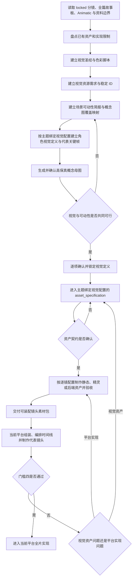

# 中国神话视频美术设计与资产工作流

本流程负责把锁定的导演方案转化为一致、可追溯、可实现的视觉圣经、色彩脚本、角色视觉定义和平台资源需求。它管理“应该长什么样”和“每个镜头需要什么”，不提前决定目标平台如何拆件、分层、绑定或渲染。

上游流程：[导演工作流](%E5%B7%A5%E4%BD%9C%E6%B5%81-%E5%AF%BC%E6%BC%94.md)。

总控规则：[全流程总控工作流](%E5%B7%A5%E4%BD%9C%E6%B5%81-%E5%85%A8%E6%B5%81%E7%A8%8B%E6%80%BB%E6%8E%A7.md)。

概念设计子流程：已有主题从锁定主题配置解析 `visual_profile`；尚未绑定的新主题才读取[项目配置的默认视觉 profile](%E5%B7%A5%E4%BD%9C%E6%B5%81-%E9%A1%B9%E7%9B%AE%E9%85%8D%E7%BD%AE.md#%E8%A7%86%E8%A7%89%20profile)。

下游流程：先由主题绑定的 `visual_profile` 解析 `asset_specification`，再由 `implementation_profile` 依次解析 `platform_asset_authoring` 与 `visual_prototyping`；本流程不绑定具体引擎。

> [!important] 核心原则
> **先从镜头可动性反推概念图，再锁定视觉系统与高保真概念母图；只有概念图已经覆盖未来所需的姿态、状态、接触和遮挡，才可拆件、合成正式资产并由当前实现仓库审阅锁定。门槛四必须审阅当前平台的真实代表镜头。**
>
> 概念图数量和平台资源数量都不等于美术完成。只有身份、风格、比例、光向、动作和技术规格能在真实平台代表镜头中共同成立，才可以进入全片制作。

> [!note] 历史兼容
> 已绑定 v1–v9 的现有主题继续按其原平台无关资产、组件拆分、Godot／Remotion 流程、source manifest 和导入记录读取，不迁移、不批量改写。v10 使用 `asset_specification` 和[跨仓库资产所有权工作流](%E5%B7%A5%E4%BD%9C%E6%B5%81-%E8%B7%A8%E4%BB%93%E5%BA%93%E8%B5%84%E4%BA%A7%E6%89%80%E6%9C%89%E6%9D%83.md)。

## 输入与默认产物

必需输入：

- 共同 `locked` 的导演方案／分镜总表、全篇视觉故事板和全片 Animatic 记录；
- 该分镜绑定的中文母版剧本和资料包；
- 角色、场景、道具、特效、屏幕文字和声音提示需求；
- 画幅、分辨率、帧率与实现方式；
- 主题绑定的 `visual_profile`、`visual_profile_version`、`implementation_profile` 和 `implementation_profile_version`；
- 已有可复用资产、版权边界和技术限制。

默认产物：

```text
projects/<project_id>/content/视觉设计/
├── README.md
├── 视觉圣经-v1.md
├── 色彩脚本-v1.md
├── 角色/
├── 场景/
├── 关键帧定义/
├── 提示词/
│   ├── 角色/
│   ├── 场景/
│   ├── 道具/
│   └── 特效/
└── 审阅记录/

projects/<project_id>/content/素材清单/
└── 视觉资源需求-v1.md
```

如果主题已经有稳定目录和文件名，优先更新现有索引，不为了套模板重复创建同义文件。

正式提示词正文保存在本项目 `content/视觉设计/提示词/`，绑定稳定 prompt_id、版本、asset_id 与视觉定义。候选可记录实际完整提示词和内容哈希；送审前核对并形成唯一正式版本，不能维护第二套独立正文。

## 镜头素材规划与输出

每个镜头都必须检查并登记是否需要动态素材；sprite-gen 可选，逐镜素材决策必做。此步骤在镜头素材规划和输出阶段完成，不能等到 Blender／Godot 组装镜头时再临时决定角色怎样动。导演先给出动作意图和时间边界，美术与素材制作据此锁定实现方式并输出可装配的镜头素材包。

### 逐镜素材配置表

在既有 `素材清单/视觉资源需求-v<版本>.md` 中按“镜号 × 素材 ID × 动作状态”登记，允许多镜引用同一锁定资产版本；同一素材在不同镜头中的入出点与动作相位分别记录。

共享素材、动作配置与选择理由只定义一次，使用稳定配置 ID；各镜填写配置引用及入出点、相位、遮挡等差异。下表字段可由引用解析，不要求逐镜复制全文。不适用项在共享配置中统一说明；每镜必需元素和动作覆盖仍须可对账。

| 配置 | 必须记录的内容 |
|---|---|
| 镜号与上游 | 具体 locked 分镜／故事板／Animatic、镜头 fps 和帧范围 |
| 素材及用途 | 稳定 ID、主体／景层／道具／特效、前后景及遮挡关系 |
| 实现方式 | 静态图、sprite-gen 精灵动画、后端 rig／三维／程序化资产；混合方式须拆分到具体元素 |
| 选择依据 | 需要或不需要精灵动画的理由；后端制作项说明绕拍、接触、受光或可编辑性等必要能力 |
| 动作配置 | 起止状态、动作链、入出点、时长、关键接触／触发帧、循环或单次、循环相位和结束策略 |
| 运动分工 | 素材烘焙的局部动作与后端控制的位移、相机、层级、可见性；静态图也须声明允许的整体运动 |
| 制作与交付 | 生成工具／动作方法、具体资产契约与提示词版本、输出规格、制作责任和验收证据链接 |

provider 和账户选择在 sprite-gen guide 中解析，解析后记录到生成契约，不在规划阶段猜测。逐帧时长、画布和锚点等详细规格放在资产契约；需求表引用它，不复制底层节点、Shader 或 runtime 配置。

### 素材制作与可装配交付

1. 覆盖全部镜号及其必需元素，完成实现方式选择；动作语义缺失退回导演，制作方式未决则先补齐素材方案。
2. 锁定视觉定义、资产契约和基准提示词后，在所有者仓库制作素材；契约范围内的候选补词按资产所有权的“候选提示词与正式绑定”处理。选用精灵的条目在此执行[sprite-gen 场景精灵动画](%E5%B7%A5%E4%BD%9C%E6%B5%81-%E5%9C%BA%E6%99%AF%E7%B2%BE%E7%81%B5%E5%8A%A8%E7%94%BB.md)，完成动作生成、去底、提取、对齐及连续动作验收；静态图与后端制作项各走既有契约。
3. 以镜号为索引交付素材包：静态层、已完成的精灵动作及时间／锚点信息、后端制作项清单、位置与遮挡意图、音画触发点，以及资源版本和审阅证据。素材包是对稳定资源的引用集合，不为每镜复制共享二进制。
4. 后端 rig／三维／程序化条目可先交给对应后端的资源制作子阶段；这些条目完成制作和所需验收后，才计入该镜头可装配素材包。不能以“交给后端”冒充素材已经完成。
5. 进入某镜头的正式组装前，检查该镜所有必需素材已完成动作／静态验收、锁定身份可追溯、时间映射完整且没有未决制作项。缺项时只做明确标记的技术探索；全片正式装配前对账全部镜号。状态、批准和提交沿用总控，不新增 Gate 或第二份生产总控。

### 与 Blender／Godot 的分工

素材阶段交付动作已明确、可以装配的资源。Blender／Godot 主要负责导入与场景组装、位置和路径、前后景遮挡、相机、时间线、音画同步及视频输出。只有素材配置表明确分配给后端的 rig、三维、动态受光或程序化效果才在后端制作；已烘焙精灵动作不重复制作或叠加。素材阶段的动作验收与后端真实镜头验收分别保留，后者继续按 Gate 4 执行。

## 状态协议

### 阶段产物状态

阶段产物使用[总控统一状态机](%E5%B7%A5%E4%BD%9C%E6%B5%81-%E5%85%A8%E6%B5%81%E7%A8%8B%E6%80%BB%E6%8E%A7.md#%E7%BB%9F%E4%B8%80%E7%8A%B6%E6%80%81%E6%9C%BA)。视觉系统完整后进入 `review`；确认后为 `approved`；成为主题 `asset_specification` 的具体输入后为 `locked`。锁定分镜发生影响性变化时为 `needs-sync`。

### 单项视觉定义／需求状态

| 状态 | 含义 |
|---|---|
| `planned` | 已登记需求，尚未建立视觉定义 |
| `in-progress` | 正在生成或整理高保真视觉定义 |
| `review` | 视觉定义完整，等待美术与权利检查 |
| `approved` | 视觉契约已经用户确认 |
| `locked` | 具体版本与确认提交已冻结，可交给平台资源流程 |
| `rejected` | 不可使用，保留原因但不进入实现 |
| `superseded` | 已被新版本替代 |
| `blocked` | 缺输入、授权或实现条件 |

平台资源使用其目标平台流程的独立状态，不写回本表。

## 美术流程



## 阶段一：锁定美术输入

先建立输入表：

| 字段 | 内容 |
|---|---|
| 主题 | 规范主题名 |
| 锁定分镜 | 具体 wikilink 与版本 |
| 锁定全篇故事板 | 具体 wikilink、版本与全镜覆盖状态 |
| 锁定 Animatic | 具体 wikilink、媒体版本、帧率、总帧数与总时长 |
| 中文剧本 | 具体 wikilink 与版本 |
| 资料包 | 具体 wikilink |
| 目标规格 | 画幅、分辨率、帧率 |
| 交付接口 | 视觉圣经、色彩脚本、角色视觉定义、资源需求与权利边界 |
| 视觉配置 | 主题绑定的 `visual_profile` 与版本 |
| 实现配置 | 主题绑定的 `implementation_profile` 与版本 |
| 禁止误读 | 来自资料包与分镜 |
| 已有资产 | 可复用、需返修、不可用 |

没有共同锁定的文字分镜、全篇视觉故事板和 Animatic 时，只能制作视觉探索稿，不能把整套资产标为正式版本。

> [!note] 故事板与概念母图的边界
> 全篇故事板负责证明镜头内容覆盖、构图、状态变化和连续性，允许低保真。美术阶段的代表关键帧／概念母图负责锁定身份、造型、色彩、材质和风格。故事板中的临时视觉细节不得未经美术确认直接升格为生产视觉定义。

### 阶段一-A：场景可动性简报（概念图生成前置门槛）

在为**人物、动物、植物、道具、可识别场景物体或特效母件**生成任何正式概念图前，必须从锁定分镜逐镜建立场景可动性简报。它描述视觉对象将如何在镜头中出现和变化，不指定平台的骨骼、pivot、节点或动画参数。

| 字段 | 要求 |
|---|---|
| 对象 ID／类别 | 对应稳定资源 ID；明确人物、动物、植物、道具、景物或特效母件 |
| 对应镜号 | 所有使用该对象的镜号及动作节拍 |
| 独立性 | 是否需要独立位移、视差、旋转、显隐、替换、遮挡、被持取或被释放；静态元素也要明确“静态” |
| 状态与轮廓 | 起止状态、极值姿态、开合／破损／变形等会改变轮廓的状态 |
| 接触与遮挡 | 脚底／根部／手持点／喙夹点／落点／受遮挡边缘，以及必须完整可见的部分 |
| 概念图覆盖 | 需要哪一张概念母图、补充姿态图或状态图来证明上述条件；不能只用一张美观但不可用的场景图 |
| 实现边界 | 当前视觉路线允许用完整姿态替换、独立景层、组件、遮罩或整体变换中的哪一种表达；不写实现数值 |

概念图必须按此简报设计，而不是先生成一张完整场景再要求后端“想办法拆开”。如果对象被其他对象、手、衣物、植物枝叶或场景边缘永久遮住，导致所需的独立运动、接触、替换或遮挡无法可靠实现，必须在概念阶段补充可用视图／状态或调整构图；不得把问题留给生成式补全、拆件或平台实现。

- 人物和动物：概念图至少覆盖分镜真正需要的朝向、关键整身姿态与持取／接触状态；不以骨架图替代高保真造型图。
- 植物：先判断主茎、叶组、花果是否需要风摆、弯折、开合、掉落或前景遮挡；需要独立运动的部分不得烘焙成不可分离的整片风景。
- 道具和物品：先判断是否需被拿起、衔取、投掷、放下、开合、破损、变形或作为遮挡；概念图须留出完整轮廓及可读接触区，不能只画在角色手中或背景里。
- 场景与特效母件：先判断是否需视差、换景、前景遮挡、循环或状态替换；需要独立控制的山、树、云、浪、火、烟等必须以可独立理解的概念对象出现。

## 阶段二：视觉圣经

视觉圣经至少定义：

1. **来源与创作边界**：哪些识别特征有 A／B 级来源，哪些服饰、纹样、表情和构图属于 D 级美术设定；
2. **形状语言**：人物、神祇、异兽、山水、云火和法术的轮廓原则；
3. **材质语言**：皮革、纸张、墨色、金属、织物或粒子如何统一；
4. **比例系统**：角色身高、道具尺寸、场景尺度和远近缩放；
5. **视角系统**：角色侧身／正侧、场景透视、光向和镜头轴；
6. **纹样规则**：可复用纹样、禁用装饰及时代边界；
7. **排版系统**：标题、原文、来源、字幕和“改编演绎”标识；
8. **技术边界**：透明背景、图层、像素尺寸、色彩空间和安全区；
9. **连续性**：服饰、伤痕、天气、时段、道具状态和色彩变化；
10. **负面清单**：不允许出现的现代符号、错时代元素、水印、乱码和身份漂移。

视觉圣经不是图片合集。每条规则都应能指导资产验收或镜头实现。

## 阶段三：色彩脚本与关键帧

按幕或情绪段记录：

| 段落 | 主色 | 明度／对比 | 光向 | 情绪变化 | 连续性要求 |
|---|---|---|---|---|---|
| 示例 | 赭红＋青黑 | 中低明度 | 画左逆光 | 安全→不安 | 下一幕保持冷色入口 |

完成场景可动性简报后，优先制作 3–6 张代表关键帧／概念母图，至少覆盖：

- 主要角色首次出现；
- 核心场景与空间关系；
- 最大情绪或动作转折；
- 关键特效；
- 结尾视觉状态。

关键帧用于确认构图、色彩和动作。纸偶路线还必须选择其中一组作为 `concept_master`：后续透明角色、独立道具和场景纸层必须从该母图确定性拆出，或以它作为高保真身份参考派生后再拆出；不能跳过母图直接画代码轮廓。

每张概念母图还必须标明它覆盖的可动性简报条目。若某个镜头所需状态、轮廓、接触区或独立对象在所有概念图中均不可见或不可推导，概念图包不完整，不得进入资产契约或生成。

## 阶段四：视觉资源需求与稳定编号

建议编号：

| 前缀 | 类别 |
|---|---|
| `CH` | 角色与表情 |
| `BG` | 背景与场景 |
| `EV` | 环境层次与天气意图 |
| `PR` | 道具 |
| `FX` | 特效意图 |
| `TX` | 标题、原文和屏幕排版 |
| `KF` | 关键帧 |

每项需求至少记录：

| 字段 | 要求 |
|---|---|
| `id` | 主题内唯一且稳定，用于跨阶段追踪语义，不承诺跨平台复用同一文件 |
| 名称与类别 | 人类可读名称及资源类型 |
| 对应镜号 | 哪些锁定镜头需要它 |
| 来源层 | A／B 特征与 D 级设定边界 |
| visual definition | 对应角色、场景或道具的高保真视觉定义 wikilink |
| version | `v1`、`v2` 等 |
| status | 视觉定义／需求状态 |
| platform intent | 当前平台需要验证的动作、分层、接触、特效或排版能力 |
| 镜头素材配置 | 逐镜实现方式、精灵选用理由、动作与时间边界、素材／后端运动分工及契约链接 |
| concept motion coverage | 对应场景可动性简报条目及证明它的概念图／补充状态图；未覆盖即为 `blocked` |
| rights | 自制／生成／授权／待确认 |
| prompt | `prompt_id`、版本和 `projects/<project_id>/content/视觉设计/提示词/` wikilink |
| replaces | 被替代版本 |

需求清单不保存 pivot、骨架、React 组件、runtime 路径或 Shader 参数。`asset_specification` 按主题绑定视觉配置锁定资产单位、组件语义、视觉约束和验收条件；目标实现必须按该契约直接生成，不得在 项目内容区 建立生产副本。

## 阶段五：按视觉配置建立定义

角色、场景、道具和特效的概念设计必须从项目配置解析当前 `visual_profile`，不得因项目过去使用皮影就继续猜测风格。

当前 `shadow_puppet` 配置使用：

[皮影角色视觉定义工作流](%E5%B7%A5%E4%BD%9C%E6%B5%81-%E7%9A%AE%E5%BD%B1%E8%A7%92%E8%89%B2%E8%A7%86%E8%A7%89%E5%AE%9A%E4%B9%89.md)

`paper_theater` 配置使用：

[纸偶小剧场视觉定义工作流](%E5%B7%A5%E4%BD%9C%E6%B5%81-%E7%BA%B8%E5%81%B6%E5%B0%8F%E5%89%A7%E5%9C%BA%E8%A7%86%E8%A7%89%E5%AE%9A%E4%B9%89.md)

皮影流程批准高保真角色视觉定义并交给组件资产路线；纸偶流程批准完整静态姿态、舞台景层和道具状态定义。两者都不得在概念页中写入平台代码、路径或时间轴参数。

### 资产契约与平台实现边界

| 资产类型 | 本流程交付 | `asset_specification` 交付 | 当前平台拥有 |
|---|---|---|---|
| 角色 | 高保真视图、比例、材质、配色、识别特征、表演能力与禁用项 | 皮影：组件树与叶子件规格；纸偶：完整静态姿态／朝向／表情状态规格 | 候选／正式图片、runtime 路径、定位、节点／组件、时间轴和动画 |
| 背景／环境 | 空间、构图、色彩、光向和前中后景意图 | 只在视差、遮挡、换景或独立运动需要时定义景层契约 | 候选／正式景层、相机、视差、材质、转场和合成 |
| 道具 | 外观、尺度、状态和接触意图 | 皮影可形成组件；纸偶形成完整道具状态 | 抓取／定位语义、约束和时间变化 |
| 特效 | 视觉目标、遮罩／纹理意图和禁用效果 | 根据逐镜选择锁定纹理／遮罩、精灵动作或后端程序化效果契约 | 素材阶段生成的序列帧、Shader、粒子和合成工程 |
| 精灵动画 | 镜号、动作与节拍、选用理由和运动分工 | 动作状态、透明画布、锚点、逐帧时长、循环和结束策略；素材阶段完成生成与动作验收 | 稳定路径中的帧／图集及元数据、导入适配、场景装配与镜头时间线 |
| 排版 | 文本 ID、字体、版式、安全区和语言要求 | 不可本地化装饰或书法图形 | UI／React 组件、字体资源与 locale 加载实现 |

跨平台迁移时保持视觉定义和已锁定资产契约；只有明确建立共享资产仓库时才像素级复用二进制，不让某个实现仓库成为隐式上游。

## 阶段六：视觉定义验收

### 视觉验收

- 身份、物种、年龄感和来源识别特征没有漂移；
- 造型、材质、纹样和色彩符合视觉圣经；
- 主视图和必要补充视图足以约束后续平台生成；
- 角色、场景和道具比例一致；
- 光向、视角和透视适配目标镜头；
- D 级美术设定没有伪装成历史复原。
- 每个需要独立运动、接触、遮挡或状态替换的人物、动物、植物、物品和场景母件，都有可用概念图覆盖；没有把未来必动部分烘焙进不可分离的场景构图。

### 交接验收

- 每项需求有稳定 ID、对应镜号和具体视觉定义版本；
- 表演需求按能力、接触和轮廓约束表达，没有提前写死平台结构；
- 简易骨架、关节线、代码轮廓、结构占位件和编号拆件板没有作为默认视觉母件；
- 纸偶路线已经锁定高保真概念母图，并建立“母图区域／身份 → 语义部件 → 纸层 → 合成资产”的映射；
- 概念图、关键帧、平台无关视觉母件与平台工程资源边界清楚；
- 视觉配置、实现配置及各自版本已写入主题产物；
- 平台字段没有写入角色视觉定义。

### 权利验收

- 自制、生成、外部授权和待确认内容已区分；
- 外部参考没有被误标为可直接使用；
- 授权范围、署名要求和禁止用途已记录；
- 权利状态不清的视觉定义不得进入 `approved`。

## 交接到视觉资产制作与平台接入

视觉定义包一经用户确认、纳入当前阶段里程碑提交并锁定具体版本，必须先交给主题绑定视觉配置的 `asset_specification`。同一连续审阅批次可合并提交，不为逐图或微状态重复提交。资产契约确认并锁定后，按本页“镜头素材规划与输出”在目标仓库直接制作和验收素材；后端制作项由 `platform_asset_authoring` 承担。可装配素材包交给主题绑定后端组装镜头和时间线，不必等待整片 Gate 4。

交接时必须提供：

- [ ] locked 文字分镜、全篇视觉故事板、Animatic 与中文剧本链接；
- [ ] 主题视觉／实现配置和版本；
- [ ] 已确认并锁定具体版本的高保真视觉定义包；
- [ ] 来源特征、D 级设定与禁止漂移项；
- [ ] 对应镜号和文字化动作能力；
- [ ] 场景可动性简报与概念图覆盖映射；
- [ ] 权利状态和外部参考使用边界；
- [ ] 视觉定义确认 commit。

当前 `shadow_puppet` 配置先进入[角色组件分层拆分与提示词生成工作流](%E5%B7%A5%E4%BD%9C%E6%B5%81-%E8%A7%92%E8%89%B2%E7%BB%84%E4%BB%B6%E5%88%86%E5%B1%82%E6%8B%86%E5%88%86%E4%B8%8E%E6%8F%90%E7%A4%BA%E8%AF%8D%E7%94%9F%E6%88%90.md)。v10 只在 项目内容区 保存组件文档、提示词和叶子件验收规格；透明叶子候选直接写入目标 Godot 仓库。

主题绑定 Godot 时，随后进入[Godot 主入口·资源生成与装配](https://github.com/lseyesl/ancient-tales-godot/blob/main/docs/backend/README.md)。它按逐镜素材配置接入已验收静态图和精灵动画；仅对分配给后端的组件／rig 条目生成叶子件并建立 pivot／节点／骨骼测试动作。两类资源均沿用稳定路径和 manifest 状态。

`paper_theater` 配置进入[纸偶小剧场静态资产工作流](%E5%B7%A5%E4%BD%9C%E6%B5%81-%E7%BA%B8%E5%81%B6%E5%B0%8F%E5%89%A7%E5%9C%BA%E9%9D%99%E6%80%81%E8%B5%84%E4%BA%A7.md)，锁定完整静态姿态、景层、道具状态的规格与稳定 ID。后续后端资源阶段由主题绑定的实现主入口解析；例如 `remotion_paper_theater` 使用[Remotion 纸偶主入口·资源制作与接入](https://github.com/lseyesl/skills/blob/main/skills/shadow-puppet-part-splitter/SKILL.md)。

## 门槛四边界

本流程提供视觉圣经、色彩脚本、视觉定义、关键帧和资源需求，但不单独负责 Gate 4。Gate 4 由主题绑定实现配置的 `visual_prototyping` 使用真实平台资源和 3–5 个代表镜头完成。

平台视觉样片必须从主题绑定实现 profile 的 `visual_prototyping` 路由解析。静态关键帧可以作为样片目标，但不能独立通过 Gate 4。

## 完成检查

- [ ] 锁定文字分镜、全篇视觉故事板、Animatic、中文剧本和资料边界链接准确。
- [ ] 视觉圣经、色彩脚本和代表关键帧完整。
- [ ] 主题绑定了具体视觉／实现配置版本。
- [ ] 每个镜头所需资源都有稳定 ID、视觉定义和状态。
- [ ] 全部镜号已登记素材实现方式及是否选用精灵动画；动作、时间和制作分工没有留给组装阶段猜测。
- [ ] 正式组装的镜头已交付可装配素材包，所需静态／精灵／后端制作项均已验收并锁定。
- [ ] 主要角色、场景、环境、道具、特效和排版需求完整。
- [ ] 每项有可动性需求的对象均在生成概念图前完成场景可动性简报，并由概念图／状态图覆盖；不可实现的构图已在概念阶段返修。
- [ ] 视觉定义不包含平台拆件、骨架、节点和导入参数。
- [ ] 简易骨架、关节线、代码轮廓和结构占位件未成为生产美术母件。
- [ ] 纸偶路线已确认高保真概念母图，并能追溯所有正式纸层与合成资产到该母图。
- [ ] 已确认视觉定义按阶段里程碑提交，未按逐图微节点制造重复 commit。
- [ ] 当前 `asset_specification` 能从这些输入建立并确认资产契约。
- [ ] 当前平台流程只能按锁定契约在所有者仓库直接生成、审阅和晋升资源。
